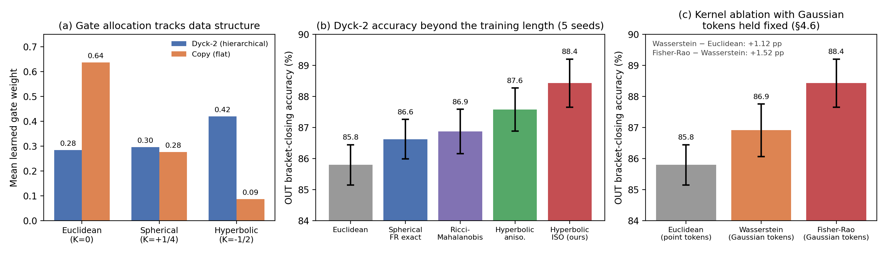

# Fisher–Rao Geodesic Attention

[](https://doi.org/10.5281/zenodo.23424909)

**Spherical and hyperbolic attention from information geometry.**

This repository accompanies the preprint [`paper_draft.md`](paper_draft.md) (LaTeX source in [`arxiv/`](arxiv/)). It contains the code, raw outputs and pre-registration protocols of the experiments (the scripts of §4.9 are available on request, the corpus of §4.8g is not redistributed, and the uncertainty-calibration test mentioned below used a separate codebase and is not included). The experiments listed under [Reproducing the benchmark](#reproducing-the-benchmark) run on a laptop CPU (≈5 h on the original laptop, 2 h 10 min on an Apple M4 Max; no GPU required).



## The idea in three sentences

Standard attention scores tokens by inner products in a flat space. We map queries and keys to probability distributions and score them by their exact Fisher–Rao geodesic distance; once the distributional family is chosen, invariance under sufficient statistics fixes the metric up to scale (Chentsov's theorem): categorical tokens give a *spherical* kernel (K = +1/4), isotropic Gaussian tokens a *hyperbolic* one (H^(d+1); K = −1/2 in the paper's convention), and Euclidean distance attention is the flat Gaussian location family at fixed σ. The isotropic Gaussian kernel is hyperbolic distance attention written in half-space coordinates, and its exact distance needs one matrix multiplication plus an elementwise arccosh on an L×L matrix (2.3–2.8× the cost of a dot-product attention module on three CPUs; ≈1.4× end-to-end training time).

On Dyck-2 with matched parameters and a fixed training budget, closing-bracket accuracy beyond the training length ranks **dot-product 85.8% < spherical 86.6% < hyperbolic-isotropic 88.4%** (5 paired seeds, p = 0.0009 for hyperbolic vs. dot-product). The margin is the same within the training length (+2.74 pp within, +2.64 pp beyond), so it reflects better learning of nested structure, not a separate extrapolation effect.

## Headline results

| Attention kernel | Curvature | Dyck-2 OUT accuracy | Params | Training time vs. standard |
| :--- | :---: | :---: | :---: | :---: |
| Euclidean (dot product) | 0 | 85.80% ± 0.65 | 413k | 1× |
| Spherical Fisher–Rao (exact) | +1/4 | 86.63% ± 0.64 | 413k | ≈1.1× |
| Ricci–Mahalanobis (quadratic approx.) | approx. | 86.87% ± 0.71 | 413k | ≈4× |
| Hyperbolic anisotropic (exact) | −1/2 per factor | 87.58% ± 0.69 | 479k | 28–110× (module only, three machines) |
| **Hyperbolic isotropic (exact, ours)** | **< 0** | **88.43% ± 0.77** | **415k** | **≈1.4×** |
| Mixed-curvature adaptive (gated) | learned | 86.90% ± 0.72 | 418k | ≈1.8× |

OUT: lengths 80–120 after training on 20–60; mean ± sd over 5 paired seeds.

**Extended evidence (§4.8).** The headline contrast holds over **20 paired seeds** (Δ = +2.10 pp, 95% CI [1.74, 2.46], p = 1.9×10⁻¹⁰, 20/20) and is larger in one 19M-parameter configuration (+4.7 pp, 3/3 seeds; one configuration, not a scaling trend). The advantage does **not** grow with hierarchy depth (pre-registered H1 refuted), and in-distribution modeling of natural data favors dot-product attention throughout.

**Natural data (§4.8d–g).** These are character-level CPU models with learned absolute positions whose rows beyond the training length are never trained; they stay near character-bigram quality (3.60–3.64 bpc on English prose, against 3.74 for a bigram and 2.42 for a 4-gram). In that setting a norm-capped variant degrades less than dot-product attention beyond the training length on Python source (after two pre-registered failures of the original kernel; n = 20, Δ = −0.084 bpc, p = 0.0037, 15/20 seeds) and on technical English prose (first attempt; n = 10, Δ = −0.058 bpc, p = 0.0002, 10/10), but **not** on Spanish clinical text (n = 20, Δ = +0.004 bpc, 95% CI [−0.007, +0.014], p = 0.45). This is not evidence about natural-language extrapolation at scale.

Further findings (Sections 4.5–4.9, 5–5.3 and 6 of the paper):

- **The gain is carried by the geodesic kernel, not by Gaussian tokens (§4.6).** Holding the Gaussian token representation fixed and swapping only the score, the Wasserstein–Bures kernel (the geometry used by prior stochastic transformers, arXiv:2311.18645) gains +1.12 pp over point-token attention, and the Fisher–Rao kernel adds a further **+1.52 pp** (p = 0.029). A KL (Bregman) kernel, which shares the Fisher metric locally but grows quadratically where the geodesic grows logarithmically, reaches 87.32%: Fisher–Rao beats it by **+1.11 pp** (95% CI [0.44, 1.78], p = 0.010, 5/5 seeds). These controls do not separate curvature from slow score growth: a variant with one fixed scale per head still reaches 87.69% (unpaired comparison, §4.9).
- **The advantage does not depend on absolute positional embeddings (§4.8f).** With relative (rotary) positions in both arms, a pre-registered test on 20 paired seeds (6–25) keeps the lead on Dyck-2 (92.73% vs. 90.91%, +1.82 pp, p = 6×10⁻⁵, 16/20), equally within and beyond the training length; on the copy task the lead beyond the training length is +5.60 pp (p = 0.0002), above the +2.79 pp within it.
- **What the learned scale encodes (§4.9).** In pre-registered probes, second-layer query scales narrow (×0.69 per nesting level) and key scales widen (×1.18) with depth in every head and seed (20/20 head–seed pairs; 5/5 seeds). The code is strongly decodable, but removing it from the query scales at test time costs 0.15 pp beyond the training length and 0.41 pp within it; it was not detected on program source at this scale, and its cause remains open.
- **A positive-definite variant keeps most of the advantage (§4.5).** The geodesic Gaussian kernel exp(−βd²) is not positive definite on curved spaces, but the geodesic Laplacian exp(−βd) is on hyperbolic space (Feragen et al., CVPR 2015). Swapping it in gives 87.88%: +2.08 pp over dot-product attention (p = 0.008) and a non-significant −0.55 pp versus the Gaussian form.
- **A threshold-gated efficiency result (§4.7).** Above a head-width threshold ($d_h \ge 16$, with four heads), the hyperbolic kernel at dimension $D$ shows no significant accuracy difference from Euclidean attention at dimension $2D$ ($p = 0.27$ and $0.74$; 95% CIs within ±1 pp) while using **≈3.8–3.9× fewer parameters**, and at the largest scale tested (d_model 128 vs. 256) trains roughly 1.5× faster. Below the threshold ($d_h \le 8$) the effect reverses and hyperbolic attention is significantly worse; this is not a universal speedup.
- **Geometry selection follows data structure (§5).** A gated mixture of the three kernels — re-instantiating the adaptive mixed-curvature idea of CAT (arXiv:2510.01634), which is prior work — allocates 0.42 of its gate weight to the hyperbolic kernel on hierarchical data and collapses it to 0.09 on flat data (Euclidean gate: 0.28 → 0.64). We use the gate as a diagnostic probe, not as a claimed novelty.
- **A pre-specified negative result for adaptivity (§5.1).** On a mixed-structure stress test the adaptive mixture *lost* to the pure hyperbolic kernel (p = 0.0013): the explicit gate added no accuracy over the pure kernel on these tasks. Reading negative curvature as a default that contains near-flat behavior is consistent with the data but not demonstrated by it.
- **No significant difference from the curvature-adaptive incumbent on sequences (§5.3).** Against a reimplementation of CAT's central mechanism (per-token routing among Euclidean, Poincaré and spherical branches, tuned to avoid a strawman), the pure Fisher–Rao kernel reaches 88.43% vs. 88.13% on Dyck-2 (+0.30 pp, 95% CI [−0.91, +1.51], p = 0.53; no equivalence margin was pre-specified) at ≈70% of its training time; CAT-style itself beats dot-product attention (+2.34 pp, p = 0.0071).
- **A negative result against dedicated hyperbolic methods (§5.2).** On the WordNet-mammals embedding benchmark, the Fisher–Rao kernel is far ahead of Euclidean embeddings (+0.49 MAP at D = 10) but is **beaten by Poincaré embeddings** (0.883 vs. 0.941, p = 0.0002; our Poincaré reimplementation reproduces the published MAP ≈ 0.93). It is not a better hierarchy embedder.
- **Two further applied hypotheses tested and refuted (outside the attention mechanism).** The scale parameter $\sigma$ is not a usable predictive-uncertainty signal (AUC-ROC ≈ 0.49, chance level). In few-shot hierarchical classification, the Fisher–Rao geometry is *outperformed* by both Euclidean and Poincaré at low sample counts (p = 0.0003 vs. Poincaré at k = 10/class).

**Re-execution (Appendix A).** The second author re-ran the 14 experiments of the block below on separate hardware: on synthetic and fixed data, 976 of 976 numeric values are bit-identical to the published result files; the two natural-data endpoints were met again under drifted corpora; and a pre-registered follow-up with the original kernel on a CPython 3.13 corpus did **not** meet its primary endpoint (p = 0.36). Logs, result files, corpus manifests and the sealed protocol are in [`reproduccion/`](reproduccion/).

## Repository structure

```
.
├── paper_draft.md                  # The preprint in Markdown (generated from arxiv/main.tex)
├── arxiv/                          # LaTeX source of the arXiv version (main.tex), abstract and figures
├── README.md
├── LICENSE                         # MIT (code); paper text and figures © the authors
├── CITATION.cff, .zenodo.json      # citation and archive metadata
├── requirements.txt
├── reproduccion/                   # Appendix A: re-execution on separate hardware (logs, result files,
│                                   #   corpus manifests, sealed follow-up protocol); notes in LEEME.md (Spanish)
└── verificacion_claude/            # All code, raw outputs, and figures
    │
    │   # --- Core experiments (Sections 4–5 of the paper) ---
    ├── exp_tres_geometrias.py      # Main benchmark: Euclidean / spherical / hyperbolic-anisotropic,
    │                               #   5 seeds, paired t-tests  (~30 min)
    ├── exp_ricci_addendum.py       # 4th arm: quadratic Ricci–Mahalanobis approximation  (~25 min)
    ├── fast_gaussian_test.py       # IsotropicHyperbolicAttention (the paper's main kernel),
    │                               #   speed micro-benchmark + ablations  (~15 min)
    ├── exp_mixta.py                # MixedCurvatureAttention + gate analysis on Dyck-2 vs Copy  (~20 min)
    ├── exp_mixta2.py               # §5.1 mixed-structure stress test (negative result)  (~25 min)
    ├── exp_wasserstein_vs_fisherrao.py  # §4.6 geometry-vs-representation ablation
    │                               #   (Fisher-Rao vs Wasserstein, same Gaussian tokens)  (~10 min)
    ├── exp_wordnet_incumbentes.py  # §5.2 vs real incumbents (Poincaré/Lorentz) on
    │                               #   WordNet mammals; needs nltk+wordnet  (~40 min)
    ├── exp_wordnet_final.py        # D = 10 variant of the §5.2 comparison with Poincaré at another learning rate
    │                               #   (the table of §5.2 comes from exp_wordnet_incumbentes.py)
    ├── exp_eficiencia_dimensional.py  # §4.7 parameter/compute efficiency sweep  (~20 min)
    ├── exp_mecanismo_umbral.py     # §4.7 pre-registered probe of the threshold mechanism  (~3 min)
    ├── exp_ablacion_kernel.py      # §4.5–4.6 KL/Bregman and geodesic-Laplacian ablations  (~15 min)
    ├── exp_cat_incumbente.py       # §5.3 CAT-style reimplementation, pilot tuning, head-to-head  (~20 min)
    │
    │   # --- Extended evidence (§4.8) ---
    ├── exp_respuesta_escala.py     # §4.8a–b 20-seed extension and 19M-parameter scale probe
    ├── exp1_profundidad.py         # §4.8c pre-registered depth-stratified Dyck-4 test
    ├── exp_codigo_python.py        # §4.8d in-distribution character-level Python modeling
    ├── exp_codigo_extrapolativo.py, exp_codigo_extrapolativo_rep.py
    │                               # §4.8d pre-registered code length-extrapolation (original kernel)
    ├── diag_sigma_extrapolacion.py, diag_sigma_ronda2.py
    │                               # §4.8d failure-mode diagnosis (outlier μ norms); output in log_diag_sigma_*.txt
    ├── exp_estabilizado.py         # §4.8d stabilized kernel (μ-norm cap), pre-registered n=20
    ├── manifiesto_corpus_codigo.py/.json  # file list, Python version and SHA-256 of the §4.8d code corpus
    ├── exp_sensibilidad_cap.py     # §4.8d cap-robustness analysis
    ├── exp_rope.py                 # §4.8f pre-registered relative-position (RoPE) test
    ├── PREREGISTRO_ROPE.md, SELLO_PREREGISTRO_ROPE.txt  # its protocol and pre-run SHA-256 seal
    ├── exp_prosa_man.py            # §4.8e pre-registered English-prose length-extrapolation
    │                               #   (corpus rendered from the local system manual)
    ├── manifiesto_corpus_man.py/.json  # page list, OS version and SHA-256 of that corpus
    ├── ngram_referencia.py         # §4.8e character n-gram baselines on that corpus (bigram, 4-gram)
    ├── PREREGISTRO_FASE2_CPU.md    # October 2026 pre-registrations (prose, CAT, threshold probe)
    ├── guias_es/                   # §4.8g pre-registered test on Spanish clinical text: protocol, seal,
    │                               #   corpus manifest, list of the 82 guidelines with public URLs, script, log and
    │                               #   results (corpus text not redistributed)
    ├── sigma/                      # §4.9 what the learned scale encodes: six sealed protocols with their
    │                               #   logs and results (scripts available on request; see LEEME.md)
    ├── busqueda_novedad.md         # §7 prior-art search: query log and verdicts on the nearest hits (in Spanish)
    │
    │   # --- Raw outputs (regenerated by the scripts above) ---
    ├── resultados_tres_geometrias.json
    ├── resultados_ricci_addendum.json
    ├── resultados_fast_gaussian.json
    ├── resultados_mixta.json
    ├── resultados_mixta2.json
    ├── resultados_wasserstein_vs_fr.json
    ├── resultados_wordnet_incumbentes.json
    ├── resultados_eficiencia_dimensional.json
    ├── resultados_ablacion_kernel.json, resultados_cat_incumbente.json,
    │   resultados_prosa_man.json, resultados_mecanismo_umbral.json,
    │   resultados_wordnet_final.json, resultados_ngram_referencia.json, ...
    ├── log_*.txt                   # console output of the October 2026 runs and of the §4.8d diagnosis
    ├── fig_results.py, fig_results.png  # results figure of the paper, plotted from the result JSONs
    ├── figuras_geometria.py        # geometry figures and the interactive scene (EN/ES text; same data and seeds)
    ├── fig_geometrias_3d.png, fig_semiespacio_hiperbolico.png, fig_tokens_reales_esfera.png,
    │   geometrias_interactivas.html, tokens_esfera_*.npy   # their outputs and the stored trained-token data (the training/extraction script for tokens_esfera_*.npy is not included)
    │
    │   # --- Applied follow-up (out of scope of the attention mechanism;
    │   #     distance-based classifier, not attention — see §6 of the paper) ---
    ├── exp_fewshot_jerarquia.py     # Few-shot hierarchical classification vs.
    │                               #   Euclidean/Poincaré — refuted, FR loses at low k
    │
    │   # --- Historical / diagnostic (earlier project iterations, kept for provenance) ---
    ├── diag_ricci.py               # Diagnosis of the original Ricci-flow formulation
    │                               #   (metric saturation, curvature-sign analysis)
    ├── train_compare.py            # Pilot benchmark (smaller config)
    ├── train_fisher_rao.py         # First exact spherical kernel
    ├── v2_test.py, v2_baselines.py # Intermediate verification runs
    ├── multi_seed.py               # Pilot multi-seed comparison
    └── resultados_*.txt, multi_seed_results.json
```

## Reproducing the benchmark

Requires Python ≥ 3.9. CPU is sufficient (the original numbers were produced on a laptop CPU; the re-execution of Appendix A ran on a Mac Studio CPU and, for three scripts, on a Colab x86-64 CPU). The §4.8d code corpus is read from the standard library of the running interpreter; the reported numbers were produced with CPython 3.9.6, and exact reproduction also needs the same standard-library files: a later macOS build of 3.9.6 already differs in two of them (Appendix A.4). The SHA-256 manifest is in `verificacion_claude/manifiesto_corpus_codigo.json`, and `python manifiesto_corpus_codigo.py` checks a local interpreter against it.

```bash
pip install -r requirements.txt
cd verificacion_claude

# Main 3-geometry benchmark (5 seeds, paired stats)        ~30 min
python exp_tres_geometrias.py

# 4th arm: Ricci–Mahalanobis approximation                 ~25 min
python exp_ricci_addendum.py

# Isotropic hyperbolic kernel + speed micro-benchmark      ~15 min
python fast_gaussian_test.py bench    # speed table (ms/step; printed only)
python fast_gaussian_test.py acc      # accuracy, 5 seeds

# Geometry-selection experiment (gates on Dyck-2 vs Copy)  ~20 min
python exp_mixta.py

# Mixed-structure stress test (§5.1)                       ~25 min
python exp_mixta2.py

# Geometry-vs-representation ablation (§4.6)               ~10 min
python exp_wasserstein_vs_fisherrao.py

# vs. real incumbents: Poincaré/Lorentz on WordNet (§5.2)   ~40 min
# requires: pip install nltk  (downloads WordNet corpus on first run)
python exp_wordnet_incumbentes.py

# Parameter/compute efficiency sweep (§4.7)                 ~20 min
python exp_eficiencia_dimensional.py

# KL/Bregman and geodesic-Laplacian kernel ablations (§4.5–4.6)   ~15 min
python exp_ablacion_kernel.py

# CAT-style head-to-head (§5.3)                             ~20 min
python exp_cat_incumbente.py

# Natural data (§4.8d–e): stabilized kernel on code, then on technical prose
python exp_estabilizado.py        # ~25 min
python exp_prosa_man.py           # ~10 min (renders the corpus from local man pages)

# Relative positions (RoPE) in both arms, Dyck-2 and copy (§4.8f)   ~45 min
python exp_rope.py
```

Each script prints per-seed results and summary statistics and, except the speed benchmark (`bench`) and the two `diag_sigma_*` diagnostics, writes a `resultados_*.json` with the raw numbers. Training seeds are fixed in each script — 1–5 for the Dyck-2 and WordNet benchmarks (1–3 for the copy arms of `exp_mixta.py`), 16–35 for `exp_estabilizado.py`, 46–55 for `exp_prosa_man.py` and 6–25 for `exp_rope.py`; the other scripts in the tree state theirs in-line (e.g. 6–20 in `exp_respuesta_escala.py`, 36–40 in `exp_sensibilidad_cap.py`, 6–8 in `exp_mecanismo_umbral.py`). Data-generation seeds and every hyperparameter are also fixed in-line, so runs are deterministic on CPU. The verdict lines that some scripts print (for example "transferencia extrapolativa ... DEMOSTRADA" or "empate estadístico") were written with the experiments and predate the wording of v1.2; the scripts are kept unmodified, and the paper's conclusions are those of its text.

### Using the kernel in your own model

The paper's main mechanism is self-contained in one class — `IsotropicHyperbolicAttention` in [`verificacion_claude/fast_gaussian_test.py`](verificacion_claude/fast_gaussian_test.py) (~40 lines). It is a drop-in replacement for a multi-head attention block: same input/output shapes, causal mask supported, one extra hyperparameter (`eps_sigma`). The exact Fisher–Rao distance between the isotropic Gaussian tokens is

```
d(i,j) = √2 · arccosh( 1 + (‖μᵢ−μⱼ‖²/2 + (σᵢ−σⱼ)²) / (2σᵢσⱼ) )
```

with the pairwise `‖μᵢ−μⱼ‖²` computed by a single matmul.

## Honest limitations

CPU scale throughout. The baseline is dot-product attention with a fixed temperature and an untuned learning rate, trained for a short budget; Euclidean-distance attention, a model-space hyperbolic distance head and position schemes designed for extrapolation (ALiBi, NoPE, KERPLE) were not run. Curvature is not separated from slow score growth. The natural-data models are small and under-trained (near character-bigram quality) and use learned absolute positions that are never trained beyond the training length; they show that one under-trained model degrades less than another, on two corpora and not on a third, and in-distribution modeling favors dot-product attention throughout. Only the isotropic- and anisotropic-vs-Euclidean contrasts survive Bonferroni correction. The efficiency result (§4.7) is threshold-gated: in the tested four-head architecture it holds for $d_h \ge 16$ and **reverses** below that. The protocols of §4.8f, §4.8g, §4.9 and Appendix A.6 were hashed (SHA-256) before the runs they govern (for §4.9, after a recorded smoke test), without an external registry; the earlier pre-registrations were written before execution but not hashed. The protocols are written in Spanish. Several pre-specified hypotheses **failed**: geometry gating is unnecessary (§5.1), σ is not a usable uncertainty estimator (AUC ≈ 0.49), the kernel is beaten by Poincaré embeddings on static hierarchy embedding (§5.2), it is outperformed in few-shot hierarchical classification, the advantage does not grow with depth (§4.8c), and three endpoints about σ were not met (§4.9). See Section 6 of the paper before extrapolating any claim; this is a bounded, small-scale contribution, not a general advance.

## Citation

```bibtex
@misc{quinelen2026fisherrao,
  doi    = {10.5281/zenodo.23424909},
  title  = {Fisher--Rao Geodesic Attention: Spherical and Hyperbolic Attention from Information Geometry},
  author = {Qui{\~n}elen Rojas, Eduardo and Contreras Torrejon, Miguel},
  year   = {2026},
  note   = {Preprint. Code and data: https://github.com/quinelen/fisher-rao-attention},
}
```

## Use of AI tools

The original idea and the direction of the research are the authors'. AI assistants were used throughout, under the authors' direction. Claude (Anthropic) was used to draft protocols and to write and review the experiment code; as support to run the experiments on the authors' machines and, as a third reviewer alongside the two authors, to check them; as a second reviewer in the literature search; and to prepare the manuscript text from the authors' own drafts and proposals. The second author also used DeepSeek and Qwen to review text, to run experiments and for cross-checks. The authors reviewed and approved all content and take full responsibility for it.

## License

Code released under the [MIT License](LICENSE). The paper text and figures (`paper_draft.md`, `arxiv/` and the figure files `verificacion_claude/fig_*.png`) are © 2026 Eduardo Quiñelen Rojas and Miguel Contreras Torrejon.
