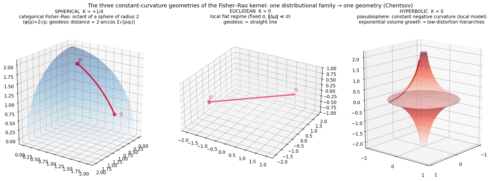
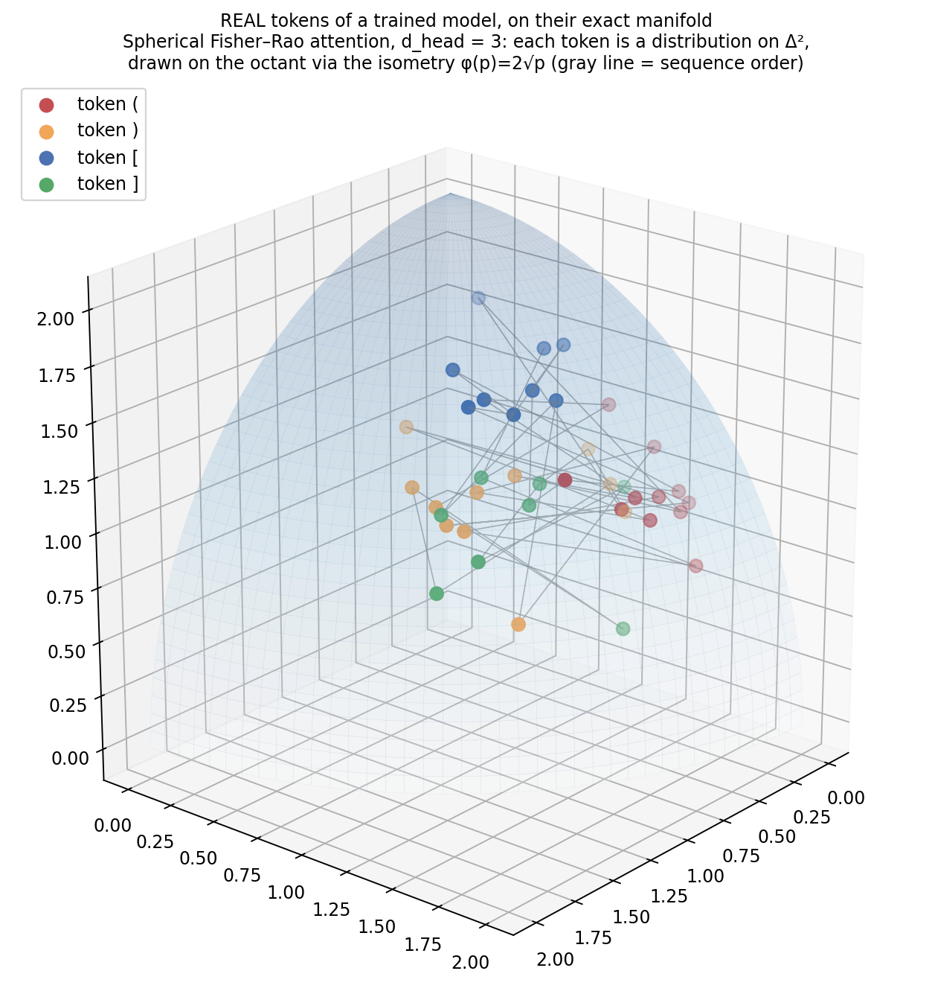
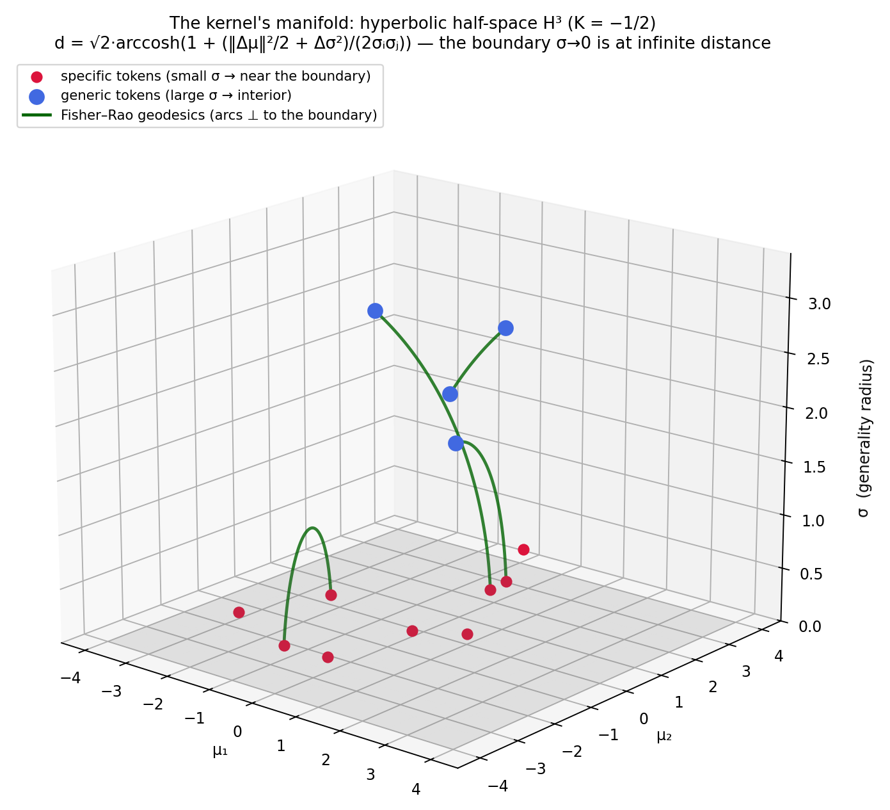

# Fisher–Rao Geodesic Attention: Exact Constant-Curvature Kernels for Sequence Models at Near-Matmul Cost

**Authors:** Eduardo Quiñelen Rojas, Miguel Contreras Torrejon
**Affiliation:** Independent researchers, Santiago, Chile
**Date:** July 2026 (v1); October 2026 (this version)
**Code:** all attention experiments reproducible from the scripts in `verificacion_claude/` (see Reproducibility Statement)

---

## Abstract

Standard attention measures token similarity by inner products in an arbitrary, parameterization-dependent Euclidean space. We propose a family of attention mechanisms in which queries and keys are probability distributions and similarity is the **exact Fisher–Rao geodesic distance** on the corresponding statistical manifold. The choice of distributional family remains a design decision — but once a family is chosen, Chentsov's theorem determines the metric uniquely (the only Riemannian structure invariant under sufficient statistics), replacing the ad-hoc selection of a model space with a single principled degree of freedom: categorical distributions give a **spherical** manifold ($K=+1/4$), isotropic Gaussians give a genuine **hyperbolic** space $\mathbb{H}^{d+1}$ ($K<0$), and Euclidean distance attention is recovered as the *local* flat regime of the Gaussian family (at fixed $\sigma$, $d_{\text{FR}} \to \lVert\Delta\mu\rVert/\sigma$ for separations small relative to $\sigma$; the point-mass limit itself is singular, as Fisher information diverges as $\sigma \to 0$). Computationally, both curved kernels admit exact closed-form geodesic distances whose pairwise computation reduces to one matrix multiplication plus an elementwise transcendental on an $L \times L$ matrix — $2.3\times$ the cost of a standard attention module, versus $28\times$ for a naive per-coordinate formulation (§3.2). On Dyck-2 length extrapolation with matched parameter budgets, accuracy ranks Euclidean $85.8\%$ < spherical $86.6\%$ < hyperbolic-isotropic $\mathbf{88.4\%}$; the headline contrast holds over **20 paired seeds** ($\Delta = +2.10$ pp, $t = 12.21$, $p = 1.9\times10^{-10}$, 20/20 seeds) and **widens at $46\times$ model scale** ($+4.7$ pp at 19M parameters, 3/3 seeds, §4.8). Ablations that hold the Gaussian token representation fixed attribute the gain to the global hyperbolic geometry: the Fisher–Rao kernel beats both a Wasserstein–Bures kernel and a KL (Bregman) kernel that shares its local information geometry ($+1.11$ pp, $p = 0.010$, 5/5 seeds; §4.6), and a positive-definite geodesic Laplacian variant retains most of the advantage over Euclidean attention ($+2.08$ pp, $p = 0.008$; §4.5). These Dyck-2 results use learned absolute positional embeddings; with relative (rotary) positions in both arms — implemented in the Fisher–Rao kernel as an exact isometry of the hyperbolic space — the advantage persists in a pre-registered test on 20 paired seeds ($+1.82$ pp, $p = 6\times10^{-5}$), equally within and beyond the training length, and on a copy task the lead beyond the training length is $+5.6$ pp ($p = 0.0002$), above the $+2.8$ pp within it (§4.8f). Two pre-specified probes bound the claim: the advantage does *not* grow with stack depth (present at all depths but front-loaded at shallow–mid), and in-distribution modeling of natural data (real code and English prose) remains in Euclidean attention's favor. Far *length-extrapolation* on natural data, however, transfers: on real code, after two pre-registered failures traced to a diagnosed instability (outlier $\mu$ norms at unseen positions), a one-line $\mu$-ball cap passed the pre-registered endpoint at $n{=}20$ seeds new to the code task ($\Delta = -0.084$ bpc, $p = 0.0037$; §4.8d), and the same stabilized kernel passed a separately pre-registered endpoint on a previously unused corpus of technical English prose at its first attempt ($n{=}10$, $\Delta = -0.058$ bpc, $p = 0.0002$, 10/10 seeds; §4.8e). A dimension sweep (§4.7) shows this translates into a genuine, if threshold-gated, efficiency gain: for $d_h \ge 16$, the hyperbolic kernel at dimension $D$ shows no significant accuracy difference from Euclidean attention at dimension $2D$ ($p>0.25$; 95% CIs within $\pm 1$ pp) while using $\approx 3.8$–$3.9\times$ fewer parameters and, at the largest scale tested, training roughly $1.5\times$ faster; below that threshold the effect reverses and hyperbolic is worse. Finally, re-instantiating the (prior) idea of adaptive mixed-curvature attention [10, 11, 12] in this information-geometric setting, we use a causal input-dependent gate as a diagnostic probe: its weights track data structure (hyperbolic gate $0.42$ on hierarchical input, collapsing to $0.09$ on a flat copy task), but a pre-specified stress test shows the pure hyperbolic kernel matching or beating the gated mixture even on heterogeneous data, and a pre-registered head-to-head against a reimplementation of the central mechanism of the curvature-adaptive incumbent (CAT) on sequence extrapolation ends in a statistical tie (88.4% vs. 88.1%, $p = 0.53$; §5.3) — results *consistent with*, though not yet demonstrating, the reading that negative curvature can act as a superset default rather than requiring explicit geometry routing.

**Keywords:** information geometry, Fisher–Rao metric, hyperbolic attention, mixed curvature, statistical manifolds, length extrapolation, geometric deep learning.

---

## 1. Introduction

Scaled dot-product attention measures similarity in a flat vector space whose metric depends entirely on the learned parameterization: it possesses no intrinsic geometric invariance. A long line of work has argued that hierarchical structure — trees, nested grammars, ontologies — embeds with low distortion only in negatively curved spaces [3, 4, 5], and hyperbolic networks have shown gains on hierarchy-heavy tasks. Their adoption, however, has been limited by two frictions: the geometry is imposed *a priori* (the designer must know the data is hierarchical), and hyperbolic operations have historically carried significant computational overhead.

This paper addresses both frictions inside a single formalism. We are careful to separate what is novel here from what re-instantiates known ideas (see Section 7 for detailed positioning; adaptive mixed-curvature attention in particular is prior work [10, 11, 12], not a contribution of this paper). Our contributions:

1. **An information-geometric unification of attention geometries.** Mapping queries and keys to probability distributions and equipping the family with the Fisher–Rao metric reduces geometry selection to a single principled design choice — the distributional family — after which the metric is determined by Chentsov's theorem [1] (the unique metric invariant under sufficient statistics). Categorical families yield spherical geometry, isotropic Gaussian families yield genuinely hyperbolic geometry, and Euclidean distance attention arises as the *local* flat regime of the Gaussian family at fixed $\sigma$ (not as a point-mass limit, which is singular — Fisher information diverges as $\sigma \to 0$). We are explicit that this shifts rather than eliminates design freedom: the family choice, and the dimension-independent curvature convention of Eq. (1′), remain modeling decisions. The contrast with prior mixed-curvature transformers, which select model spaces (Poincaré/Lorentz/hypersphere) with fixed or learnable curvature [10, 11, 12], is that here the curvature is a *consequence* of a statistical modeling choice rather than an independently tuned geometric hyperparameter.
2. **An exact isotropic-Gaussian hyperbolic kernel at near-matmul cost.** The closed-form Fisher–Rao geodesic between isotropic Gaussian tokens (Eq. 2) reduces its pairwise computation to one matrix multiplication plus $O(L^2)$ scalar operations (Section 3.3): $2.3\times$ the cost of a standard attention module ($\approx 1.4\times$ in end-to-end training time), versus $28\times$ for the naive per-coordinate hyperbolic product manifold.
3. **Controlled evidence that the global hyperbolic geometry drives the gain.** On Dyck-2 with parameter-matched models, out-of-distribution accuracy ranks flat < spherical < hyperbolic. The hyperbolic-isotropic mechanism is ahead of every other arm — significantly against the Euclidean, spherical and Ricci-approximation arms (only the Euclidean contrast survives Bonferroni correction) and directionally against the larger anisotropic variant ($p = 0.063$) — and its contrast with Euclidean attention holds over 20 paired seeds and widens at $46\times$ scale (Section 4, §4.8a–b). Ablations that hold the Gaussian token representation fixed show the gain is carried by the global geometry: Fisher–Rao beats both a Wasserstein–Bures kernel and a KL (Bregman) kernel that shares its local information geometry (§4.6). With relative (rotary) positions in both arms, the advantage persists (§4.8f).
4. **A threshold-gated parameter/compute efficiency result.** Above a head-width threshold ($d_h \ge 16$), the hyperbolic-isotropic kernel reaches accuracy comparable to (not significantly different from) Euclidean attention at double the dimension using $\approx 3.8$–$3.9\times$ fewer parameters and, at the largest scale tested, less real wall-clock training time; below the threshold the effect reverses (Section 4.7). This is the paper's only positive resource-efficiency claim against Euclidean attention, after three other efficiency/advantage hypotheses were tested and refuted in follow-up work (graph embedding, §5.2; few-shot classification, whose script is in the project repository; uncertainty calibration, run in a separate codebase that is not included — the latter two out of scope for the attention mechanism proper).
5. **A negative result on the necessity of geometry gating.** Re-instantiating the adaptive mixed-curvature idea [10] in our information-geometric setting, we find (via a pre-specified stress test, §5.1) that the pure hyperbolic kernel matches or beats the gated mixture even on structurally heterogeneous data — suggesting negative curvature functions as a superset default rather than requiring explicit routing. A pre-registered comparison against a reimplementation of the central mechanism of the incumbent curvature-adaptive transformer (CAT) on sequence extrapolation — to our knowledge the first evaluation of that mechanism on sequence data rather than graphs — ends in a statistical tie with the pure kernel, which is simpler and faster (§5.3). The gate remains useful as a diagnostic probe of data structure (Section 5).

---

## 2. Background: One Theorem, Three Curvatures

### 2.1 Attention heads as maps to statistical manifolds

Let $x \in \mathbb{R}^{d_{\text{model}}}$ be a token embedding. Each head projects tokens into a parametric family of probability distributions rather than into raw vectors. The Fisher information metric

$$g_{\mu\nu}(\theta) = \mathbb{E}\!\left[\partial_\mu \log p(x\mid\theta)\, \partial_\nu \log p(x\mid\theta)\right]$$

equips the family with a Riemannian structure [2]. By **Chentsov's theorem** [1], this is the unique metric (up to scale) invariant under sufficient statistics: *given the distributional family*, the geometry of the head is fixed by information theory. The family itself is the designer's choice — the framework's contribution is to concentrate all geometric freedom into that one statistically interpretable decision.

### 2.2 The three constant-curvature members

| Distributional family | Manifold | Sectional curvature | Closed-form geodesic distance |
| :--- | :--- | :---: | :--- |
| Categorical $p \in \Delta^{d-1}$ | octant of sphere of radius 2 (via $\phi(p) = 2\sqrt{p}$) | $K = +1/4$ | $d = 2\arccos\big(\sum_i \sqrt{q_i k_i}\big)$ |
| Isotropic Gaussian $\mathcal{N}(\mu, \sigma^2 I_d)$ | hyperbolic space $\mathbb{H}^{d+1}$ | $K = -1/2$ | Eq. (2) below |
| Gaussians at fixed $\sigma$, separations $\ll \sigma$ (local flat regime) | locally $\approx \mathbb{R}^d$ | $K \to 0$ effectively | $d_{\text{FR}} \to \lVert\Delta\mu\rVert / \sigma$ (Euclidean distance attention; the $\sigma \to 0$ point-mass limit is singular) |

The categorical (spherical) case: the map $\phi(p) = 2\sqrt{p}$ is an isometry from $(\Delta^{d-1}, g_F)$ onto the positive octant of the radius-2 sphere; the geodesic distance is the Bhattacharyya angle, bounded in $[0, \pi]$.

*Figure 1 — The three constant-curvature geometries of the family: the categorical Fisher–Rao octant (left, with an exact great-circle geodesic between two distributions), the local flat regime (center), and constant negative curvature (right, a pseudosphere, which is only a local model of the hyperbolic plane). Figure 3 shows the global model, the Gaussian half-space manifold, with Fisher–Rao geodesics and the generality-radius interpretation; Figure 2 shows real token distributions from a trained spherical-attention model ($d_h = 3$) rendered on their exact manifold via $\phi(p) = 2\sqrt p$ — an interactive 3D version of the curved scenes (the pseudosphere and Figures 2–3) is included in the repository (`verificacion_claude/geometrias_interactivas.html`).*

The isotropic Gaussian (hyperbolic) case: for $\mathcal{N}(\mu, \sigma^2 I_d)$ with $\mu \in \mathbb{R}^d$, $\sigma > 0$, the exact Fisher line element carries a dimension factor on the scale coordinate [6],

$$ds^2 = \frac{\lVert d\mu \rVert^2 + 2d\,d\sigma^2}{\sigma^2}, \tag{1}$$

which after rescaling $\sigma' = \sqrt{2d}\,\sigma$ becomes $2d$ times the standard upper half-space metric, i.e. hyperbolic space of curvature $K = -1/(2d)$.

**Convention (dimension-independent curvature) — and why it is a choice of units, not a departure from the theory.** Our kernel fixes the scale factor at its $d = 1$ value, using

$$ds^2 = \frac{\lVert d\mu \rVert^2 + 2\,d\sigma^2}{\sigma^2}, \tag{1'}$$

which is hyperbolic with $K = -1/2$ *independently of the head width* $d_h$, keeping the manifold constant across configurations (under the literal factor $2d$, curvature would flatten as $K = -1/(2d_h)$ with growing width, confounding cross-scale comparisons). Crucially, (1′) is **not** a different geometry from the genuine multivariate Fisher–Rao metric (1): pulling (1′) back through the linear reparameterization $\tilde\mu = \mu/\sqrt{d}$ gives exactly $\frac{1}{d}\times$ metric (1), a global homothety. Consequently $d^2_{(1)}(\mu, \sigma) = d \cdot d^2_{(1')}(\mu/\sqrt{d}, \sigma)$ identically, and since the projection $W_\mu$ is learned (absorbing the $1/\sqrt d$ rescaling) and the temperature $\beta$ is learned (absorbing the global factor $d$), *the attention function class defined by (1′) is identical to the one defined by the literal metric (1)*. The same argument covers the $1/d_h$ logit normalization in §3.3: a fixed constant absorbed by $\beta$. The convention fixes units so that reported curvatures and temperatures are comparable across widths; it does not trade theoretical fidelity for engineering convenience. To be exact about what is and is not invariant: the *magnitude* of $K$ is a units convention (any homothety rescales it), while the *sign* of the curvature — negative for the Gaussian family, positive for the categorical, zero for the flat regime — is invariant under homothety and reparameterization, and it is the sign, not the magnitude, that every experimental claim in this paper rests on. All curvature values reported for the Gaussian case, and the distance below, refer to (1′). The exact geodesic distance for this metric is [7]

$$d_{\text{FR}}\big(({\mu}_1, \sigma_1), ({\mu}_2, \sigma_2)\big) = \sqrt{2}\,\operatorname{arccosh}\!\left(1 + \frac{\tfrac{1}{2}\lVert \mu_1 - \mu_2 \rVert^2 + (\sigma_1 - \sigma_2)^2}{2\,\sigma_1 \sigma_2}\right). \tag{2}$$

Sanity limits: for $\mu_1 = \mu_2$ it reduces to $\sqrt{2}\,\lvert \ln(\sigma_2/\sigma_1)\rvert$; for $\sigma_1 = \sigma_2 = \sigma$ it is a monotone function of $\lVert\Delta\mu\rVert / \sigma$ (mean separation in noise units); it diverges logarithmically as $\sigma \to 0$ — near-deterministic tokens live near the hyperbolic boundary. The scalar $\sigma$ acts as a learned **generality radius**: broad concepts sit in the geodesically-central interior, specific tokens near the boundary, realizing the generic-to-specific ordering that hyperbolic hierarchy embeddings exploit [3].

---

## 3. Mechanisms

All variants share the standard multi-head skeleton (projections, causal mask, softmax over negative squared distance, value aggregation); only the score computation differs.

### 3.1 Spherical Fisher–Rao attention (categorical, exact, one matmul)

$$q = \mathrm{softmax}(W_Q x), \quad k = \mathrm{softmax}(W_K x) \in \Delta^{d_h - 1}, \qquad s_{ij} = -\,d_{\text{FR}}^2(q_i, k_j) = -4\arccos^2\!\big(B_{ij}\big),$$

where $B = \sqrt{Q}\,\sqrt{K}^{\top}$ is a single matrix multiplication of element-wise square roots. Because $d_{\text{FR}} \in [0, \pi]$, logits are intrinsically bounded and the kernel trains stably without a temperature parameter (Section 4.5). Implementation note: $\arccos$ has divergent gradient at $B \to 1$; we clamp $B \le 1 - 10^{-4}$.

### 3.2 Hyperbolic Gaussian attention, anisotropic (product of half-planes)

Each head projects to $d_h$ univariate Gaussians per token ($\mu = W_\mu x$, $\sigma = \mathrm{softplus}(W_\sigma x) + \varepsilon$), with squared distance summed per coordinate over the product manifold $(\mathbb{H}^2)^{d_h}$. This is the direct construction but costs $O(L^2 d_h)$ element-wise `arccosh` operations ($\approx 28\times$ Euclidean wall-clock in our measurements) and, as tested, carries extra parameters (separate $\sigma$ projections). We include it as an arm of the benchmark; the isotropic variant below is $\approx 12\times$ cheaper, parameter-matched, and at least as accurate (§4.3).

### 3.3 Hyperbolic isotropic attention (ours; exact, near-matmul cost, parameter-matched)

Take $\sigma$ **scalar per token per head**: the token is the isotropic Gaussian $\mathcal{N}(\mu, \sigma^2 I_{d_h})$, living on $\mathbb{H}^{d_h+1}$. The only pairwise vector quantity in Eq. (2) is $\lVert \mu_i - \mu_j \rVert^2 = \lVert\mu_i\rVert^2 + \lVert\mu_j\rVert^2 - 2\,\mu_i^{\top}\mu_j$ — one matrix multiplication. The `arccosh` then acts on an $[L \times L]$ matrix rather than $[L \times L \times d_h]$:

$$s_{ij} = -\beta\, \frac{2}{d_h} \operatorname{arccosh}^2\!\left(1 + \frac{\tfrac{1}{2}\lVert\Delta\mu_{ij}\rVert^2 + \Delta\sigma_{ij}^2}{2 \sigma_i \sigma_j}\right).$$

Numerical safeguards: the `arccosh` argument is clamped to $\ge 1 + 10^{-7}$, and $\sigma \ge \varepsilon$ keeps tokens off the infinitely-distant boundary. On the clamp, a point worth making precisely: the gradient singularity of $\operatorname{arccosh}$ at coincident tokens afflicts the *distance* $d$, not the *squared* distance the scores actually use — $\frac{\partial d^2}{\partial A} = 4\operatorname{arccosh}(A)/\sqrt{A^2-1} \to 4$ (finite) as $A \to 1^+$, so the score gradients are smooth on the diagonal and the clamp guards only against floating-point arguments dipping below 1, introducing no gradient bias. For length-extrapolation robustness, a third safeguard is recommended: a **$\mu$-norm ball cap** ($\lVert\mu\rVert \le c$, e.g. $c = 12$), which §4.8d shows stabilizes far-extrapolation behavior on program source under out-of-distribution positional inputs — the analogue of Poincaré ball clamping. Parameter cost matches standard attention (the $\sigma$ projections map $d_{\text{model}} \to n_{\text{heads}}$: 415k vs. 413k parameters in our configuration). Measured cost of the attention module: $2.3\times$ Euclidean ($\approx 1.4\times$ in end-to-end training time, §5.3), $12\times$ faster than the anisotropic version.

### 3.4 Mixed-curvature attention with causal data-driven gating

Each head computes all three scores — $s^{\text{euc}}$ (dot product), $s^{\text{sph}}$ (§3.1), $s^{\text{hyp}}$ (§3.3, sharing the same $q k^{\top}$ matmul) — and blends them per position:

$$s_{ij} = \alpha^{\text{euc}}_i\, s^{\text{euc}}_{ij} + \alpha^{\text{sph}}_i\, s^{\text{sph}}_{ij} + \alpha^{\text{hyp}}_i\, s^{\text{hyp}}_{ij}, \qquad \alpha_i = \mathrm{softmax}\big(W_g\, \bar{x}_{\le i}\big) \in \Delta^2,$$

where $\bar{x}_{\le i}$ is the **cumulative (causal) mean** of the input up to position $i$ — the gate observes only the past, preserving autoregressive validity. Per-head, per-geometry learnable temperatures calibrate the heterogeneous logit scales. The gate values $\alpha$ are also the mechanism's built-in interpretability probe: they report, per position, head, and layer, which geometry the model is *choosing to think in*.

---

## 4. Experiments: Curvature and Length Extrapolation

### 4.1 Protocol

**Task.** Dyck-2 (balanced sequences over `()` and `[]`), autoregressive next-token training with strict causal masking. Models train on lengths 20–60 and are evaluated out-of-distribution (OUT) on lengths 80–120. The discriminative metric is **bracket-closing type accuracy**: at positions whose target is a closing bracket, whether the model prefers the correct closing type — a direct probe of stack tracking; cross-entropy is reported as a calibration measure.

**Configuration (identical across arms).** $d_{\text{model}} = 128$, 2 layers, 4 heads, 10{,}000 training samples, batch 64, AdamW ($lr = 5\times10^{-4}$, weight decay 0.01), 5 epochs, 5 paired seeds, CPU (PyTorch 2.8). Sequences are padded per batch; loss ignores padding.

### 4.2 Main results

| Attention mechanism | Curvature | OUT accuracy (mean ± sd) | OUT loss | Params | Training time† |
| :--- | :---: | :---: | :---: | :---: | :---: |
| Euclidean (dot product) | $0$ | 85.80% ± 0.65 | 1.314 ± 0.028 | 413k | $1\times$ |
| Spherical FR exact (§3.1) | $+1/4$ | 86.63% ± 0.64 | 1.316 ± 0.031 | 413k | $\approx 1.1\times$ |
| Ricci–Mahalanobis (quadratic approx.)* | approx. | 86.87% ± 0.71 | 1.298 ± 0.038 | 413k | $\approx 4\times$ |
| Hyperbolic anisotropic (§3.2) | $-1/2$ | 87.58% ± 0.69 | 1.295 ± 0.054 | 479k | $\approx 28\times$‡ |
| **Hyperbolic isotropic (§3.3, ours)** | $<0$ | **88.43% ± 0.77** | 1.309 ± 0.040 | **415k** | $\approx 1.4\times$ |
| Mixed-curvature adaptive (§3.4) | learned | 86.90% ± 0.72 | — | 418k | $\approx 1.8\times$ |

*\*The quadratic midpoint-metric approximation from an earlier iteration of this project, retained as an ablation arm. †End-to-end training time relative to Euclidean attention in the §4.1 configuration. ‡Attention-module micro-benchmark only (§4.4); on that micro-benchmark the isotropic kernel costs $2.3\times$.*

**Accuracy ranks flat < spherical < hyperbolic.** The hyperbolic advantage is what the volume-growth argument for hierarchy embedding predicts [3, 5]; the spherical kernel's small edge over flat attention ($p = 0.043$, uncorrected) is not predicted by it. The parameter-matched isotropic mechanism is the strongest arm: it wins all five seeds against every other arm except the anisotropic hyperbolic variant, which it beats in four of five (§4.3).

### 4.3 Statistical analysis

Paired two-sided $t$-tests over 5 shared seeds (df = 4):

| Contrast (OUT accuracy) | $\Delta$ | $t$ | $p$ |
| :--- | :---: | :---: | :---: |
| **Isotropic vs. Euclidean** | **+2.64 pp** | **+8.80** | **0.0009** |
| Isotropic vs. spherical | +1.81 pp | +4.60 | 0.010 |
| Isotropic vs. Ricci-approx. | +1.56 pp | +4.83 | 0.0085 |
| Isotropic vs. anisotropic | +0.85 pp | +2.55 | 0.063 |
| Anisotropic vs. Euclidean | +1.79 pp | +5.57 | 0.0051 |
| Anisotropic vs. spherical | +0.96 pp | +3.69 | 0.021 |
| Spherical vs. Euclidean | +0.83 pp | +2.92 | 0.043 |

With Bonferroni correction across the seven contrasts of this table ($\alpha = 0.05/7 \approx 0.0071$), only the isotropic-vs-Euclidean and anisotropic-vs-Euclidean contrasts remain significant; the remaining contrasts are reported uncorrected. Beyond individual $p$-values, the ranking flat < spherical < hyperbolic (both hyperbolic arms) holds in every seed.

**The parameter confound is resolved by design:** the anisotropic arm carries 16% extra parameters (479k), but the *strongest* arm — isotropic — is parameter-matched to the Euclidean baseline (415k vs. 413k) and matches or exceeds the larger anisotropic model ($+0.85$ pp, $p = 0.063$, 4/5 seeds).

### 4.4 Computational cost

Forward+backward of a single attention module (not a full training step), $B{=}32$, $L{=}60$, $d{=}128$, single CPU thread:

| Kernel | ms (fwd+bwd, one module) | relative |
| :--- | :---: | :---: |
| Euclidean | 16.7 | $1\times$ |
| Hyperbolic isotropic (matmul decomposition) | 38.5 | $2.3\times$ |
| Log-Bhattacharyya approximation (5-D broadcast) | 348.4 | $21\times$ |
| Hyperbolic anisotropic exact (5-D broadcast) | 476.1 | $28\times$ |

The decisive factor is not the transcendental function but tensor materialization: any per-coordinate pairwise formulation pays the $[B, H, L, L, d_h]$ broadcast; the isotropic reduction is what removes it. Because the projections and feed-forward layers are shared costs, the end-to-end training-time overhead is smaller than the module-level ratio: $\approx 1.4\times$ Euclidean in the §4.1 configuration (§4.2, §5.3).

### 4.5 Ablations

**Temperature.** The spherical kernel trains equally well with fixed unit temperature as with a learnable one (a learnable $\beta$ initialized at 8 drifted downward and slightly *underperformed*, 86.2% vs. 87.6% single-seed) — consistent with the intrinsic boundedness $d^2_{\text{FR}} \in [0, \pi^2]$ supplying adequate logit range. The unbounded hyperbolic kernel does use a learnable temperature (one scalar per layer).

**Log-Bhattacharyya approximation.** Replacing the exact hyperbolic distance with the Gaussian log-Bhattacharyya coefficient (correct locally: the Bhattacharyya Hessian is $\tfrac14 g_F$) reached 87.9% (single seed) but is both slower (Table 4.4) and weaker than the exact isotropic kernel.

**Kernel shape: a positive-definite geodesic kernel.** The score $-\beta d^2$ makes each attention row a geodesic Gaussian kernel $\exp(-\beta d^2)$, which on a curved manifold is not positive definite for all $\beta$; the geodesic Laplacian kernel $\exp(-\beta d)$, in contrast, is positive definite on hyperbolic space [21]. The distinction matters for scaling, because random-feature and linear-attention approximations require a positive-definite kernel. Replacing the score by $s_{ij} = -\beta\, d_{\text{FR}}(i,j)/\sqrt{d_h}$ — same Gaussian tokens, same §4.1 configuration and seeds — gives $87.88\% \pm 1.16$ OUT accuracy: $+2.08$ pp over Euclidean attention (95% CI $[0.91, 3.26]$, paired $t = 4.91$, $p = 0.008$, 5/5 seeds) and $0.55$ pp below the Gaussian form, a difference that is not significant ($p = 0.16$; 95% CI for Fisher–Rao minus Laplacian $[-0.35, 1.46]$ pp). The positive-definite form thus retains most of the geometric advantage, which keeps a route open to linear-time variants of the kernel; equivalence with the Gaussian form is not established at $n = 5$, and no such approximation is tested here.

### 4.6 Isolating the source of the gain: geometry vs. distributional tokens

The closest prior mechanism to our hyperbolic kernel represents tokens as Gaussians and scores attention by the *Wasserstein* (Bures) distance [13], not the Fisher–Rao geodesic. This is a consequential distinction: the Wasserstein geometry of Gaussians is not hyperbolic, whereas the Fisher–Rao geometry is. We therefore ablate the *geometry* while holding the *token representation* fixed — identical isotropic-Gaussian $\mu, \sigma$ projections and architecture, changing only the pairwise distance. For isotropic Gaussians the Bures distance also has matmul-friendly closed form $W_2^2 = \lVert\Delta\mu\rVert^2 + d_h\,\Delta\sigma^2$.

A second control separates the *global* geometry of the Fisher–Rao kernel from its *local* information geometry. The Kullback–Leibler divergence between the same isotropic Gaussians — the Bregman divergence of the log-partition function — agrees with the Fisher metric to second order, so it shares the kernel's local information geometry; but it grows quadratically with mean separation, whereas the hyperbolic geodesic grows logarithmically, which is how negative curvature shows up in these coordinates. It too reduces to one matrix multiplication: $\mathrm{KL}(q_i \Vert k_j) = \tfrac12\big[d_h\,\sigma_i^2/\sigma_j^2 + \lVert\Delta\mu_{ij}\rVert^2/\sigma_j^2 - d_h - d_h \ln(\sigma_i^2/\sigma_j^2)\big]$, used as $s_{ij} = -\beta\,\mathrm{KL}(q_i \Vert k_j)/d_h$.

| Kernel (Dyck-2, 5 paired seeds) | Geometry | OUT accuracy |
| :--- | :--- | :---: |
| Euclidean | flat, point tokens | 85.80% ± 0.65 |
| Wasserstein–Bures (Gaussian tokens) | optimal transport, non-hyperbolic | 86.91% ± 0.85 |
| KL / Bregman (Gaussian tokens) | local information geometry, non-hyperbolic | 87.32% ± 0.77 |
| **Fisher–Rao (Gaussian tokens, ours)** | **hyperbolic** | **88.43% ± 0.77** |

Using Gaussian tokens at all contributes $+1.12$ pp over the point-token baseline (Wasserstein vs. Euclidean, paired $t=3.07$, $p=0.037$); *choosing the hyperbolic Fisher–Rao geometry rather than Wasserstein* contributes a further $+1.52$ pp (paired $t=3.33$, $p=0.029$) — the larger share (Figure 4c). The KL control sharpens the attribution. With the same tokens and the same local information geometry, KL reaches $87.32\%$ — above Euclidean attention ($+1.52$ pp, $p = 0.0006$) and level with Wasserstein ($+0.41$ pp, $p = 0.23$) — but the Fisher–Rao kernel exceeds it by $+1.11$ pp (95% CI $[0.44, 1.78]$, paired $t = 4.60$, $p = 0.010$, 5/5 seeds). What Fisher–Rao adds over KL is not the local metric, which the two share, but the global behavior of the geodesic. The advantage is thus carried by the global hyperbolic geometry — the logarithmic growth of distance that negative curvature produces — rather than by distributional tokens or by information geometry per se, in the direction predicted by the curvature-for-hierarchy thesis.

### 4.7 Parameter and compute efficiency: matching accuracy at lower dimension

Sections 4.2–4.6 compare geometries at matched $d_{\text{model}}$, which matches parameter count but leaves open a different question, closer in spirit to the original motivation for hyperbolic embeddings [3]: since hyperbolic space packs exponentially more distinguishable structure into a fixed number of dimensions than Euclidean space, can the hyperbolic-isotropic kernel reach a *given* accuracy using *fewer* dimensions — i.e., fewer parameters and less compute — than Euclidean attention needs to reach the same accuracy? We sweep $d_{\text{model}} \in \{16, 32, 64, 128, 256\}$ ($n_{\text{heads}}=4$ fixed, so $d_h \in \{4,8,16,32,64\}$), 5 paired seeds — with 2,000 training sequences and 400-sequence evaluation sets, otherwise the §4.1 configuration, so absolute accuracies sit below those of §4.2 — and compare each geometry against the *other* geometry at **double the dimension**.

| Comparison | Fisher–Rao params | Euclidean params | Ratio | $\Delta$ accuracy | Wall-clock (5 ep.)* |
| :--- | :---: | :---: | :---: | :---: | :---: |
| FR@$d_h{=}4$ vs. Eucl.@$d_h{=}8$ | 8.9k | 29.6k | 3.3$\times$ | $-2.59$ pp ($p=0.0047$) | ≈4 s vs. ≈2 s |
| FR@$d_h{=}8$ vs. Eucl.@$d_h{=}16$ | 30.1k | 108.3k | 3.6$\times$ | $-1.53$ pp ($p=0.0020$) | ≈4 s vs. ≈3 s |
| **FR@$d_h{=}16$ vs. Eucl.@$d_h{=}32$** | **109.3k** | **413.2k** | **3.8$\times$** | $+0.22$ pp ($p=0.27$) | **≈4 s vs. ≈4 s** |
| **FR@$d_h{=}32$ vs. Eucl.@$d_h{=}64$** | **415.3k** | **1612.8k** | **3.9$\times$** | $-0.11$ pp ($p=0.74$) | **≈6 s vs. ≈9 s** |

*\*Per 5-epoch run, recorded in whole seconds.*

At small head width ($d_h \le 8$) the hyperbolic kernel does **not** achieve this: it is significantly *worse* than Euclidean attention at double the dimension, so no efficiency claim holds in this regime. Above a threshold ($d_h \ge 16$), the pattern inverts: Fisher–Rao at dimension $D$ shows no significant accuracy difference from Euclidean at dimension $2D$ (paired $t$-test, $p = 0.27$ and $p = 0.74$; 95% CIs of the difference $[-0.26, +0.71]$ and $[-0.98, +0.76]$ pp — no detectable difference at $n = 5$, although a deficit of up to $\approx 1$ pp cannot be excluded) while using $\approx 3.8$–$3.9\times$ fewer parameters. At the largest scale tested this is not just a parameter count artifact: real wall-clock training time is also lower for Fisher–Rao (≈6 s vs. ≈9 s, roughly $1.5\times$ faster) because the $O(d_{\text{model}}^2)$ projection cost that dominates at these widths scales quadratically with the doubled Euclidean dimension, outweighing the constant-factor `arccosh` overhead of the geodesic kernel (§4.4). We read this as a genuine, if narrow, efficiency result: *at sufficient scale, encoding tokens as points on a curved statistical manifold lets comparable accuracy be reached with a smaller latent width* — echoing, in the attention setting, the dimension-efficiency argument originally made for static hyperbolic embeddings [3]. Three qualifications keep this claim honest. First, the result is *comparable accuracy at lower resource cost*, not higher accuracy: the practical implication is a smaller model, not a better one. Second, the comparison is between two different mechanisms (the hyperbolic kernel carries small additional $\sigma$ projections and the `arccosh`), not a controlled scaling of one mechanism, so "fewer parameters" bundles the geometry with minor architectural differences; the parameter gap ($3.8$–$3.9\times$) is however far larger than those differences (<1% of either model). Third, the threshold behavior is a real limitation: this is not "hyperbolic is always more efficient," it is "hyperbolic becomes more efficient once each head has enough room to represent a mean vector and a meaningful scale," the mechanism behind the crossover at $d_h \approx 16$ is not explained by the present experiments — a pre-registered probe of one candidate, that narrow heads operate in an effectively flat regime, did not account for it (even at $d_h = 4$ the trained kernel operates beyond the curvature radius; protocol and data in the repository) — and no claim is made about where the threshold falls outside this architecture and task.

### 4.8 Extended evidence: statistical power, model scale, depth stratification, and natural data

In response to the evidentiary concerns of §6 (few seeds, small models, synthetic-only data, absolute positional embeddings), we ran six follow-up experiments. Some strengthen the central claim substantially, others bound it; all six are reported with equal weight.

**(a) Twenty seeds.** The headline contrast (hyperbolic-isotropic vs. Euclidean, §4.2 configuration) extended from 5 to 20 paired seeds: $\Delta = +2.10$ pp, paired $t = +12.21$, $p = 1.9\times10^{-10}$, with the hyperbolic kernel winning **20 of 20 seeds**. The main result is not a small-sample artifact.

**(b) The advantage grows with model scale.** At $46\times$ the parameter count (6 layers, $d_{\text{model}} = 512$, 8 heads, 19.0M parameters; 3 paired seeds), the gap *widens* rather than evaporating: OUT accuracy $87.4\% \pm 0.3$ (Euclidean) vs. $92.1\% \pm 0.6$ (hyperbolic), $\Delta = +4.72$ pp (paired $t = 8.72$, $p = 0.013$, 3/3 seeds) — more than double the $+2.1$ pp observed at the small configuration. This is the opposite of the common failure mode in which small-scale architectural gains vanish with capacity, and it is the single strongest argument that the mechanism deserves evaluation at genuine scale (GPU, natural-language corpora). Caveat: three seeds, one task family.

**(c) The advantage does *not* grow with hierarchy depth (pre-registered negative).** On Dyck-4 (4 bracket types, 4-layer models, training lengths 50–100, extrapolation 200–300), we stratified closing accuracy by the stack depth at each prediction, with the success criterion written before execution ($\Delta_{\text{deep}} > +5$ pp at $p<0.01$; H1: $\Delta$ increasing in depth). The hyperbolic kernel beat Euclidean at **every** depth (shallow $\le 4$: $+3.05$ pp, $p=0.0013$; mid 5–8: $+3.09$ pp, $p=0.0044$; deep $\ge 9$: $+1.64$ pp, $p=0.017$; $n=5$, bins of 46k–75k predictions), but the advantage *shrinks* rather than grows at depth — **H1 is refuted and the pre-registered threshold was not met.** The mechanism is a broad formal-sequence improvement, not a deep-hierarchy specialist; the intuitive "more curvature helps more nesting" scaling story is not supported. A hybrid architecture (hyperbolic early layers, Euclidean late, motivated by the §5 gate observations) was also *worse* than pure hyperbolic at depth ($\Delta = -1.62$ pp, $p = 0.010$), refuting the layer-specialization design hypothesis as well.

**(d) Natural data: far-extrapolation transfer demonstrated by a diagnosis-driven stabilized variant, after two failed attempts with the original kernel.** On character-level modeling of real Python source (the standard library of CPython 3.9.6, split by file: 1.20M characters train, 37.8k held out in 4 files; 97-symbol vocabulary including padding), the kernel is consistently *worse* in-distribution (train and test at equal length: a dedicated 3-seed run at $L{=}256$, $\Delta = +0.040$ bpc, $p = 0.09$, 3/3 seeds; and the in-distribution $L{=}128$ control of each of the three extrapolation runs below, all significant in Euclidean's favor). The fair test — the one every formal-language result of this paper predicts the kernel should win — is *length extrapolation*: train on 128-character sequences, evaluate on the portion of longer sequences beyond the trained length. We ran this test twice with pre-registered endpoints (primary: extrapolative-zone bpc at $4\times$ training length, $L{=}512$, $p<0.05$). **With the original kernel, the pre-registered endpoint failed both times** (original $n{=}5$: $\Delta = -0.077$ bpc in the kernel's favor, $p = 0.136$; independent replication $n{=}10$, seeds new to the code task: $\Delta = -0.049$, $p = 0.28$), while the *secondary* endpoint — the extrapolative zone at $2\times$ training length — favored the kernel significantly in both samples ($p = 0.027$, $p = 0.037$), and the failure mode at $4\times$ was identified as *variance*, not mean: seed-to-seed spread $2.0$–$2.4\times$ Euclidean's, with some seeds excellent and some degrading.

We then diagnosed the instability directly. Instrumenting good and bad seeds (a first hypothesis — $\sigma$ drift at unseen positions — was tested and *refuted*: $\sigma$ statistics do not separate good from bad seeds), the discriminating variable proved to be **outlier $\mu$ norms at untrained positions** (max $\lVert\mu\rVert$ 15–17 in failing seeds vs. 11–13 in good seeds, amplified by slightly larger learned $\beta$): under out-of-distribution positional inputs, unbounded $\mu$ projections occasionally throw tokens far out on the manifold, distorting the distance distribution. The minimal targeted fix is a **$\mu$-norm ball cap** ($\lVert\mu\rVert \le 12$, chosen from the diagnostic seeds before any confirmatory run) — the direct analogue of the ball-clamping universally used in Poincaré implementations.

**The stabilized kernel passed the pre-registered endpoint on the third and final attempt** ($n{=}20$ seeds new to the code task, 16–35): extrapolative-zone bpc at $L{=}512$ of $3.738 \pm 0.094$ vs. Euclidean $3.822 \pm 0.097$, $\Delta = -0.084$, paired $t = -3.30$, $\boldsymbol{p = 0.0037}$, 15/20 seeds, with the pre-specified stability criterion also met (seed-to-seed spread at most $1.5\times$ Euclidean's; observed $0.97\times$). The moderate-extrapolation zone was significant for the third consecutive independent sample ($\Delta = -0.142$, $p < 10^{-4}$); the in-distribution control remains in Euclidean's favor, as in all prior runs. We state the epistemic status precisely: the *original* kernel does not meet the far-extrapolation endpoint (two pre-registered failures); the *stabilized* variant — one additional clamp, motivated by a documented failure-mode diagnosis on separate seeds — meets it in one adequately powered pre-registered confirmation. Two fair objections deserve direct answers. *Is the cap theory-derived?* No — it is an engineering safeguard, exactly analogous to the ball-clamping every practical Poincaré implementation uses, and we present it as such. *Is $c = 12$ a tuned magic number?* A sensitivity analysis on five further fresh seeds shows the effect direction and magnitude persist across a $2\times$ range of the cap ($c = 8$: $\Delta = -0.111$; $c = 16$: $\Delta = -0.119$; 4/5 seeds each, descriptive $n=5$) — the stabilization is a robust family, not a point estimate. All three confirmatory attempts and the sensitivity analysis are reported; replication at larger scale is the natural next test.

**(e) Natural language: the extrapolation pattern transfers to technical English prose at the first attempt.** Code is natural data but not natural language, so we repeated the design of (d) on a corpus not used in any earlier experiment of this project: technical English prose rendered from the local system manual (274 man pages of section 1; 2.73M characters train / 0.42M test, split by page; 119-symbol vocabulary including padding). Everything else was held identical to (d) — character-level modeling, training at 128 characters, extrapolative-zone evaluation at $2\times$ and $4\times$ training length, the same architecture and budget — with the stabilized kernel against Euclidean attention, ten fresh seeds (46–55), and the endpoint written before execution (extrapolative-zone bpc at $L{=}512$, $p<0.05$). **The pre-registered endpoint was met at the first attempt:** $3.965 \pm 0.036$ vs. Euclidean $4.023 \pm 0.032$ bpc, $\Delta = -0.058$, paired $t = -6.02$, $\boldsymbol{p = 0.0002}$, **10/10 seeds**; the stability criterion was also met (seed spread $1.14\times$ Euclidean's, below the pre-specified $1.5\times$). The moderate-extrapolation zone ($L{=}256$) agrees ($\Delta = -0.088$, $p = 0.0002$), and the in-distribution control again favors Euclidean attention, exactly as declared in advance ($\Delta = +0.032$ bpc, $p < 10^{-4}$). This is the second natural-data family — after program source — in which the same crossed pattern (worse in distribution, better beyond the training length) appears under pre-registered endpoints; on formal languages, by contrast, the kernel leads both within and beyond the training length (§4.2, §5.1). Its scope is deliberately narrow: technical prose (manual pages are terse and repetitive relative to narrative or conversational text), character level, ≈495k parameters (the 119-symbol vocabulary and 512-position table make it larger than the §4.2 model), CPU; general-domain text at token level and at scale remains untested.

**(f) Relative positions: the advantage does not depend on absolute positional embeddings.** Every result above uses learned absolute positional embeddings, so positions beyond the training length enter as vectors that were never trained, and part of what "length extrapolation" measures is robustness to them. We therefore removed absolute positions from both arms and gave each a relative scheme: rotary embeddings (RoPE) on queries and keys for Euclidean attention, and the same rotation applied to $\mu_q$ and $\mu_k$ for the Fisher–Rao kernel. For the latter the rotation is an exact isometry of $\mathbb{H}^{d+1}$ — $\lVert R_i\mu_q - R_j\mu_k\rVert$ depends only on $i - j$, and $\sigma$ is untouched — so the geometry and the single-matmul decomposition are preserved. The test was pre-registered, with the protocol hashed before execution: 20 paired seeds fixed in the protocol (6–25), the §4.1 configuration, Dyck-2 OUT accuracy as primary endpoint, and the copy task of §5 as secondary.

| Task (RoPE in both arms, 20 paired seeds) | Euclidean | Fisher–Rao | $\Delta$ (95% CI) | $p$ | Seeds won |
| :--- | :---: | :---: | :---: | :---: | :---: |
| **Dyck-2, OUT (primary)** | 90.91% ± 1.10 | **92.73% ± 1.09** | **+1.82 pp** [1.08, 2.57] | $6\times10^{-5}$ | 16/20 |
| Dyck-2, IN | 95.76% | 97.42% | +1.66 pp | $7\times10^{-8}$ | — |
| **Copy, OUT (secondary)** | 37.85% ± 2.97 | **43.44% ± 5.00** | **+5.60 pp** [3.09, 8.10] | $0.0002$ | 16/20 |
| Copy, IN | 90.09% | 92.88% | +2.79 pp | $6\times10^{-13}$ | — |

**The pre-registered endpoint was met.** Relative positions help both arms substantially — Euclidean attention with RoPE (90.91%) exceeds even the Fisher–Rao kernel with absolute positions (88.43%, §4.2), which confirms that absolute embeddings were a real handicap — and the Fisher–Rao kernel keeps its lead under the fairer scheme ($+1.82$ pp, paired $t = 5.13$, $p = 6\times10^{-5}$). The shape of the lead is informative. On Dyck-2 it is the same within and beyond the training length ($+1.66$ vs. $+1.82$ pp; the drop from IN to OUT is 4.85 pp for Euclidean attention and 4.69 pp for Fisher–Rao; post hoc paired $t$, $p = 0.60$): the kernel learns the hierarchical task better overall, and that advantage carries intact to unseen lengths rather than adding a separate extrapolation benefit. On the copy task the lead does grow beyond the training length ($+2.79$ pp within, $+5.60$ pp beyond; the Fisher–Rao kernel degrades 2.8 pp less; post hoc paired $t$, $p = 0.025$), and copy extrapolation improves over the near-chance ≈30% of absolute positions (§5), although it remains far from solved for both arms (38–43%). With fair positions, then, the case for the kernel rests on better learning of structured sequences, an advantage that persists — and on copy partly grows — beyond the training length.

**Synthesis.** The picture these results paint is more specific than "hyperbolic helps hierarchies": the advantage is (i) robust across seeds, (ii) *amplified by model scale*, (iii) present across all hierarchy depths but front-loaded at shallow–mid depth rather than deep, and (iv) transferable to natural-data length extrapolation in program source — once a diagnosed instability (unbounded $\mu$ projections at unseen positions) is corrected by a one-line ball cap — and in English prose; and (v) not tied to absolute positional embeddings: on Dyck-2 and copy it persists with relative (rotary) positions, on Dyck-2 as a general advantage on hierarchical structure rather than an extrapolation-specific one (§4.8f). In-distribution natural-data modeling remains consistently in Euclidean attention's favor.

---

## 5. Data-Driven Geometry Selection

The mixed-curvature mechanism (§3.4) was trained, with identical hyperparameters and **no geometric supervision of any kind**, on two tasks of opposite structure: Dyck-2 (hierarchical) and a flat copy task (first half random tokens, second half an exact repetition — pure positional lookup, no hierarchy).

**Learned gate allocation (mean over positions, heads, layers, seeds):**

| Task | Euclidean gate | Spherical gate | Hyperbolic gate |
| :--- | :---: | :---: | :---: |
| Dyck-2 (hierarchical) | 0.28 | 0.30 | **0.42** |
| Copy (flat) | **0.64** | 0.28 | 0.09 |

The allocation tracks the structure of the data: hyperbolic-dominant under hierarchy, hyperbolic nearly silenced (0.09) under flat structure with the weight migrating to the Euclidean kernel. Per-layer resolution sharpens the picture: on the copy task the second layer is predominantly Euclidean (mean Euclidean gate 0.77 over 3 seeds, 0.53–0.98 per seed; in one seed all four heads reach 0.96–0.99), while on Dyck-2 the first layer specializes toward hyperbolic (mean hyperbolic gate 0.58 over 5 seeds, 0.51–0.64 per seed; single heads up to 0.85) with a more Euclidean second layer (mean Euclidean gate 0.41 vs. 0.16 in the first) — suggesting a division of labor in which early layers extract hierarchical structure in negative curvature and later layers aggregate in flat geometry, although an architecture that hard-codes this division underperformed pure hyperbolic attention (§4.8c).

**Caveats, stated plainly.** (i) On the purely hierarchical task the adaptive mixture (86.9%) does not beat the pure hyperbolic specialist (88.4%): when the data is uniformly hierarchical, mixing dilutes. (ii) Copy-task OUT extrapolation collapses to ≈30% for **all** mechanisms because absolute positional embeddings do not extrapolate — a positional confound, not a geometric one; copy-task claims are therefore restricted to gate behavior and in-distribution accuracy (where, incidentally, the isotropic kernel also leads: 83–91% vs. 62% Euclidean). With relative positions copy extrapolation improves (≈30% → 38–43%) but remains far from solved, and the Fisher–Rao kernel leads on it (§4.8f).

### 5.1 Mixed-structure stress test (pre-specified follow-up; negative result for adaptivity)

If geometry selection is valuable, the adaptive mixture should dominate every pure geometry on data whose structure *alternates within each sequence*. This prediction — (a) the mixture beats all three pure geometries on the combined metric, and (b) its gates swing within each sequence, more hyperbolic in hierarchical blocks and more Euclidean in flat ones — was written into the header of the experiment script (`exp_mixta2.py`) before it was run; we report the outcome regardless of direction. We constructed such a task: sequences interleave marker-delimited Dyck-2 blocks (hierarchical) and copy blocks (flat), training on one block pair (lengths 22–58) and extrapolating to two pairs (76–116). The combined metric averages bracket-closing accuracy (Dyck regions) and copy accuracy (predictable copy positions); 4 arms × 5 paired seeds.

| Arm | IN combined | OUT combined | OUT Dyck | OUT copy |
| :--- | :---: | :---: | :---: | :---: |
| Euclidean | 68.2% ± 0.4 | 53.7% ± 0.4 | 75.3% | 32.1% |
| Spherical | 68.3% ± 0.5 | 54.1% ± 0.4 | 76.1% | 32.2% |
| **Hyperbolic isotropic** | **69.2% ± 0.2** | **55.4% ± 0.4** | **78.3%** | **32.4%** |
| Mixed adaptive | 68.7% ± 0.3 | 54.5% ± 0.4 | 76.6% | 32.3% |

**The prediction failed.** The adaptive mixture scored above the Euclidean ($+0.75$ pp, $p = 0.056$, not significant) and spherical ($+0.31$ pp, $p = 0.039$, uncorrected) kernels but lost — significantly — to the pure hyperbolic kernel (OUT combined $\Delta = -0.91$ pp, paired $t = -7.98$, $p = 0.0013$). Moreover, the within-sequence gate swing predicted by the between-task result did not materialize: gates inside Dyck blocks (euc/sph/hyp = 0.56/0.23/0.22) barely differ from gates inside copy blocks (0.49/0.24/0.27), plausibly because the cumulative-mean gate integrates too slowly to track block boundaries.

**What the negative result suggests — an interpretation, not a demonstrated claim.** The pure hyperbolic kernel won *both* components of the mixed task — the hierarchical one by a wide margin and the flat one by parity. This admits a clean geometric reading: curvature effects vanish at scales small relative to the curvature radius $1/\sqrt{|K|}$, so a hyperbolic kernel can emulate flat attention locally (by keeping distances small in units of $\sigma$), while a flat kernel cannot emulate negative curvature at any scale. Under this reading, negative curvature would function not as a hierarchy *specialist* but as a *superset geometry* containing approximately-flat behavior as a limiting regime, making explicit geometry mixing unnecessary at the kernel level. We flag the evidential limits of this interpretation plainly: it rests on a single mixed-structure task where the hyperbolic margin over the adaptive mixture is under one point ($-0.91$ pp, $p=0.0013$), the mixture's loss is partly attributable to a design weakness of the gate (its cumulative-mean input integrates too slowly — a fixable engineering issue, not a geometric necessity), and the broader record of this project shows several settings where hyperbolic Fisher–Rao geometry does *not* help (§5.2, §6). A convincing establishment of the superset reading would require robustness across a family of tasks with systematically varied structure. What the present data do support is narrower: on these tasks, the explicit gate added no accuracy over the pure hyperbolic kernel, while remaining valuable as a *diagnostic* of which geometry the data calls for (Section 5, between-task result). A direct confirmatory experiment — measuring whether the model operates at smaller distance-to-$\sigma$ ratios inside flat blocks than hierarchical ones — is left to future work.

### 5.2 Comparison against established hyperbolic methods (negative result)

The experiments above compare against a Euclidean baseline. But in the domains where hyperbolic geometry is used in practice — ontologies, taxonomies, knowledge graphs — the incumbent is not Euclidean attention; it is the family of hyperbolic embedding methods established since 2017 [3] (Poincaré, Lorentz). A fair claim of advantage must therefore measure the Fisher–Rao kernel against *those*, on their own benchmark. We do so on the canonical task: reconstruction of the transitive closure of the WordNet mammals sub-hierarchy (1170 nodes, 6448 edges), with the standard mean-average-precision (MAP) metric, matched per-node dimensionality, and each method given its own tuned learning rate (our reimplementations reproduce the published Poincaré MAP $\approx 0.93$).

| Method | $D=5$ MAP | $D=10$ MAP |
| :--- | :---: | :---: |
| Euclidean | 0.231 ± 0.001 | 0.397 ± 0.001 |
| **Poincaré [3]** | **0.928 ± 0.005** | **0.941 ± 0.003** |
| Lorentz [10$'$] | 0.006 (diverged) | 0.764 ± 0.379 (1/5 seeds diverged; 0.953 ± 0.004 over the 4 converged) |
| Fisher–Rao isotropic (ours) | 0.524 ± 0.028 | 0.883 ± 0.007 |

**The Fisher–Rao kernel does not beat the incumbents at pure embedding.** It dominates Euclidean by a large margin ($+0.49$ MAP at $D=10$) and is competitive at higher dimension, but it is significantly below Poincaré at both dimensions ($D=10$: $\Delta = -0.059$, paired $t = -12.5$, $p = 0.0002$) and collapses at low dimension where Poincaré remains strong. Because the isotropic Fisher–Rao parameterization with $D$ coordinates is itself a model of $D$-dimensional hyperbolic space, and MAP depends only on the ordering of distances, the gap is one of parameterization and optimization rather than of geometry: for the *static embedding* problem, the Poincaré model space is easier to optimize than a distributional parameterization carrying a scale coordinate. Our contribution is therefore *not* a better hierarchy embedder; it is a drop-in attention kernel whose value, where it exists, is in the *sequence* setting (§4), not in competition with dedicated graph-embedding methods. This bounds the practical reading of the work: on the tasks those methods already serve, they remain the state of the art.

### 5.3 Head-to-head against the curvature-adaptive incumbent on sequences

The §5.1 stress test pits the pure kernel against *our* gated mixture. The stronger test is against the incumbent of that idea: CAT [10], which routes each token among Euclidean, hyperbolic and spherical attention branches through a differentiable per-token gate, and which has been evaluated only on graph data (knowledge-graph completion on FB15k-237 and WN18RR, plus node classification on Cora in an appendix). CAT's code is not public, so we reimplemented its central mechanism — per-token routing among the three model-space geometries — at our scale and label the arm "CAT-style": three branches in *model spaces* (scaled dot product; geodesic distance in a Poincaré ball reached by the exponential map at the origin, with learnable curvature $c$; angular distance on the unit hypersphere), a per-token softmax gate, per-branch per-head learnable temperatures, and query/key/value/output projections shared across branches so that parameters match the baselines (414k vs. 413k Euclidean, 415k Fisher–Rao). Our version differs from the published design in several respects: it mixes the three branch *scores* before a single softmax, whereas CAT mixes the *outputs* of separate branch attentions, each followed by its own feed-forward layer (the hyperbolic and spherical branches after their own manifold aggregation and logarithmic map); its branch scores are negative squared query–key distances (geodesic in the ball, angular on the sphere) with learnable temperatures, whereas CAT scores the hyperbolic branch by $\exp(-d)$ between projected queries and the spherical branch by an exponentiated inner product; its curvature $c$ is learnable, which CAT does not describe; and it omits CAT's entropy regularization of the gate. To avoid a strawman, CAT-style alone received a pilot tuning stage on seed 1 ($lr \in \{5\times10^{-4}, 10^{-3}\}$ × $c_{\text{init}} \in \{0.5, 1.0\}$; OUT accuracy 86.2–87.8%, best $lr = 10^{-3}$, $c_{\text{init}} = 1.0$), while the Euclidean and Fisher–Rao arms kept the published §4.1 configuration untouched. Seed 1 is shared between the pilot and the confirmatory set, which can only favor the CAT-style arm; excluding it leaves both conclusions below unchanged. The primary endpoint, written before execution, was Fisher–Rao vs. CAT-style on Dyck-2 OUT accuracy over five paired seeds.

| Arm (Dyck-2, 5 paired seeds) | OUT accuracy | Params | Wall-clock per run |
| :--- | :---: | :---: | :---: |
| Euclidean | 85.80% ± 0.65 | 413k | ≈25 s |
| CAT-style (curvature-adaptive routing, tuned) | 88.13% ± 0.34 | 414k | ≈50 s |
| **Fisher–Rao isotropic (ours)** | **88.43% ± 0.77** | 415k | ≈35 s |

**The primary contrast is a statistical tie** (Fisher–Rao − CAT-style $= +0.30$ pp, paired $t = 0.69$, $p = 0.53$; 95% CI $[-0.91, +1.51]$ pp; without seed 1, $+0.03$ pp, $p = 0.96$). Two further observations matter. First, CAT-style clearly beats Euclidean attention on sequence extrapolation ($+2.34$ pp, $t = 5.07$, $p = 0.0071$; without seed 1, $+2.72$ pp, $p = 0.0038$) — to our knowledge the first evidence that CAT's routing mechanism helps on sequence data, beyond the graph benchmarks on which it was introduced, and a reminder that the comparison is against a strong mechanism, not a weak one; the sanity contrast Fisher–Rao vs. Euclidean reproduces §4.3 exactly ($+2.64$ pp, $p = 0.0009$). Second, CAT-style shows less than half the seed-to-seed spread of the Fisher–Rao kernel ($\pm 0.34$ vs. $\pm 0.77$ pp): routing does not raise mean accuracy here, but it may stabilize training — a possibility the present five seeds can raise but not establish. What the tie licenses is a parsimony argument, not a superiority claim: a single fixed-curvature kernel, derived rather than routed, is statistically indistinguishable from the incumbent's mean accuracy at roughly 70% of its wall-clock and with no gating machinery, extending the §5.1 finding from our own mixture to the incumbent itself. The caveats are the usual ones for a reimplementation — the differences from the published design noted above could change the comparison — and the comparison covers one task family with five seeds.

---

## 6. Limitations

- **Scale and scope.** CPU training throughout. The headline contrast rests on 20 paired seeds and replicates at 19M parameters with a *larger* effect (§4.8a–b), and natural-data transfer is demonstrated for length extrapolation with the stabilized kernel on real Python source ($n=20$, §4.8d) and on technical English prose ($n=10$, §4.8e) — which substantially retires the small-sample, small-model, and synthetic-only concerns for those specific claims. The remaining scope limits are real: the natural-language evidence is a CPU-scale, character-level pilot on technical prose (narrative, conversational and web text, token-level modeling, and model scale are untested); in-distribution natural-data modeling consistently favors Euclidean attention; each stabilized-kernel result has one confirmation per data family (not yet an independent replication); and secondary results (§4.6–4.7, §5) still rest on 3–5 seeds.
- **The depth-scaling story is refuted, not open.** A pre-registered test (§4.8c) found the advantage does not increase with hierarchy depth — the intuitive "curvature matters more for deeper nesting" narrative should not be attributed to this work.
- **Multiple comparisons.** Only the isotropic- and anisotropic-vs-Euclidean contrasts survive strict Bonferroni correction (spherical vs. Euclidean, $p = 0.043$, does not); intermediate contrasts are suggestive, supported by the consistent ranking across seeds.
- **Absolute positional embeddings.** All results except §4.8f use learned absolute positional embeddings, whose rows beyond the training length are never trained. With relative (rotary) positions the Dyck-2 and copy advantages persist (§4.8f), but the natural-data experiments (§4.8d–e) have not been re-run with relative positions.
- **Gate mechanism.** The causal cumulative-mean gate selects geometry between tasks but is too sluggish to track structure changes within a sequence (§5.1); a local-window or learned-decay gate is the natural refinement, though the §5.1 result suggests kernel-level mixing may be unnecessary altogether.
- **Incumbent comparison by reimplementation.** CAT has no public code; §5.3 compares against a small-scale reimplementation of its central mechanism, tuned to avoid a strawman, on one task family with five seeds. Our version departs from the published design in the respects listed in §5.3 (it mixes branch scores rather than branch outputs, scores the branches by squared query–key distances with learnable temperatures, makes the curvature learnable and omits the gate's entropy regularization); those differences could change the comparison.
- **Attention-only intervention.** Value aggregation and residual stream remain Euclidean; the architecture is a hybrid, not a fully Riemannian network.
- **Not a hierarchy-embedding method.** On static graph embedding the kernel is beaten by dedicated hyperbolic methods (§5.2); its advantage is specific to the sequence-attention setting and does not extend to the ontology/knowledge-graph tasks where Poincaré/Lorentz embeddings are already deployed.
- **Efficiency is threshold-gated, not universal.** The parameter/compute efficiency result (§4.7) only holds for $d_h \ge 16$ in the tested architecture; at smaller head widths the hyperbolic kernel is significantly *less* accurate than Euclidean attention at double the dimension (at equal dimension the two are statistically tied). The location of this threshold in other architectures, tasks, or scales is untested, and the mechanism behind it (why the crossover occurs specifically around $d_h \approx 16$) is not explained by the present experiments — a natural target for follow-up work rather than a settled account.
- **Other efficiency/advantage hypotheses tested and refuted.** Beyond the graph-embedding result above, two further follow-up investigations (outside the scope of the attention mechanism itself, using a distance-based classifier rather than attention) found no advantage for the Fisher–Rao geometry: it was *not* a usable predictive-uncertainty signal via the scale parameter $\sigma$ (AUC-ROC $\approx 0.49$, chance level), and in few-shot hierarchical classification it was *outperformed* by both Euclidean and Poincaré baselines at low sample counts ($k \le 10$/class; $p = 0.0003$ vs. Poincaré at $k = 10$) — the opposite of the pattern one might expect from hyperbolic geometry's known data efficiency in the embedding literature. These are reported for completeness and to bound enthusiasm about the generality of §4.7's efficiency result: it is specific to the attention mechanism and the tested regime, not a general property of the geometry.

---

## 7. Related Work and Positioning of Contributions

This work sits within an active and crowded literature; we state carefully what is prior and what, to our knowledge, is not.

**Adaptive/mixed-curvature attention is prior work, not a contribution of this paper.** The idea of learning, per token, to route among Euclidean, hyperbolic, and spherical attention branches via a differentiable gate is introduced by CAT [10] and related to earlier mixed-curvature transformers [11] and mixture-of-curvature-experts LLMs [12]. Our gated mechanism (§3.4, §5) is a re-instantiation of this idea, not a novel one; we use it as a *diagnostic probe* of which geometry a task calls for, and our §5.1 stress test contributes a (negative) empirical finding about its necessity rather than the mechanism itself. §5.3 adds a direct comparison against a reimplementation of CAT on sequence extrapolation, where CAT beats Euclidean attention but ties the pure Fisher–Rao kernel.

**Gaussian/distributional tokens with distance-aware attention are also prior work.** Representing tokens as Gaussians and scoring by a distribution distance appears in stochastic vision transformers using the Wasserstein distance [13], echoing probabilistic word embeddings [8]; density-adaptive attention [14] uses Gaussians differently, modulating features with a learnable Gaussian density (learnable mean offset and scale) rather than scoring a distance between token distributions. The softmax map placing token logits on a positively curved Fisher–Rao simplex has likewise been observed before. Our point of departure from [13] is the *choice of distribution distance*: Wasserstein–Bures yields a non-hyperbolic optimal-transport geometry, whereas the Fisher–Rao geodesic yields genuine negative curvature. Section 4.6 shows this is not a cosmetic distinction — with token representation held fixed, the Fisher–Rao geometry outperforms Wasserstein by $+1.52$ pp ($p=0.029$), a larger effect than that of using Gaussian tokens in the first place.

**What we believe is new — as a synthesis, not an invention.** Relative to the above, the specific elements we could not locate in prior work are: (i) deriving the attention geometry from Chentsov invariance across *distributional families* — categorical → spherical, isotropic Gaussian → hyperbolic — as members of one Fisher–Rao formalism rather than as independent model-space choices (CAT and [11,12] use Poincaré/Lorentz/hypersphere model spaces, not the Fisher–Rao metric on distributions, and do not invoke Chentsov); (ii) the *exact* isotropic-Gaussian Fisher–Rao geodesic (Eq. 2) reduced to one matrix multiplication plus an elementwise transcendental on an L×L matrix (§3.3); and (iii) evaluation on length extrapolation — formal languages, program source and English prose — rather than knowledge graphs or vision. We stress that this is a novel *combination and analysis* of known ingredients.

**Prior-art search conducted.** A multi-source search (arXiv API, OpenReview API, Semantic Scholar, a manual Google Scholar sweep, plus general web search; July–August 2026; full query log and per-hit verdicts in `verificacion_claude/busqueda_novedad.md`) found no work computing attention scores as Fisher–Rao geodesic distances between distributional tokens. The exact phrases "Fisher–Rao geodesic attention", "information geometric attention", and "Gaussian hyperbolic attention" return zero results on arXiv, OpenReview, and Google Scholar; "Fisher–Rao attention" returns exactly one Google Scholar hit — concurrent work using the Fisher–Rao distance to *measure* attention shifts in a standard multimodal transformer, assign functional roles to tokens and reweight reinforcement-learning advantages accordingly [18] — a training signal derived from standard attention, not an attention kernel. The nearest neighbors beyond those already discussed are: a concurrent *theoretical* analysis of the Fisher–Rao geometry of attention outputs, proving that ungated attention is confined to flat statistical manifolds while multiplicative gating enables curvature [15] — theory about the geometry *of* standard attention, where the present work builds attention *from* geodesic distances, and a result that dialogues directly with our §5.1 observation that, on the tasks tested, an explicit gate added no accuracy over the pure hyperbolic kernel; a related analysis tying rotary-position-embedding temperature to the Fisher–Rao geometry of attention distributions [19]; a place-recognition pipeline using Fisher–Rao for relation features alongside hyperbolic self-attention [16]; and a wireless-networks model using a Fisher–Rao-motivated hypersphere projection *before* standard attention [17], adjacent to our spherical case (§3.1). Residual caveats: the Semantic Scholar sweep was partial (rate limits), coverage is English-only, and exact-phrase sweeps should be re-run in the week of any venue submission to catch further concurrent work.

Curvature-based analysis of information flow in networks [9] is related in spirit but addresses a different problem (graph rewiring against over-squashing); the present mechanism uses fixed constant-curvature manifolds with learned movement of representations, not dynamic metric evolution. In the source-code domain specifically, concurrent work introduces a hyperbolic GNN over abstract syntax trees with a Lorentz-model geodesic attention module for graph message-passing [20] — further evidence for hyperbolic geometry's fit to code structure, and a natural point of comparison for our sequence-level kernel on code, where it is worse in distribution but better under length extrapolation once stabilized (§4.8d).

---

## 8. Conclusion

Equipping attention with exact Fisher–Rao geodesic kernels makes the geometry of the latent space a principled and cheap degree of freedom. On hierarchical sequence extrapolation (Dyck-2), the negatively curved kernel performs best, as the curvature-for-hierarchy argument predicts: the parameter-matched hyperbolic-isotropic kernel — at $\approx 1.4\times$ the end-to-end training time of standard attention — provides the strongest gains, and ablations attribute the effect to the global hyperbolic geometry, not to the distributional representation and not to the local information geometry it shares with a KL kernel (§4.6). A positive-definite Laplacian form of the same geodesic kernel retains most of the advantage (§4.5), keeping open a route to linear-time variants. Above a head-width threshold, this translates into a genuine resource-efficiency result: accuracy comparable to Euclidean attention at roughly a quarter of the parameters and, at the largest scale tested, less wall-clock compute (§4.7) — comparable performance from a smaller model, not better performance. Within that regime the data are consistent with reading negative curvature as a safe default whose small-scale limit approximates flat behavior (§5.1), under which an explicit geometry gate proves diagnostic rather than necessary — a reading that now survives a head-to-head with the curvature-adaptive incumbent itself (a tie, §5.3), though establishing it beyond the present tasks remains open.

The evidence now spans six positive results — the hyperbolic-vs-Euclidean extrapolation advantage, robust over 20 seeds ($p = 1.9\times10^{-10}$), its persistence with relative (rotary) positions in a separately pre-registered 20-seed test ($p = 6\times10^{-5}$, §4.8f), amplification of the effect at $46\times$ model scale, threshold-gated resource efficiency, attribution of the gain to the global hyperbolic geometry rather than to the distributional representation or the local information metric, and, after a diagnosis-driven stabilization, demonstrated transfer to length extrapolation on two natural-data families: real program source ($n{=}20$, $p = 0.0037$, §4.8d) and English technical prose ($n{=}10$, $p = 0.0002$, 10/10 seeds, §4.8e) — alongside seven pre-specified hypotheses that were tested and failed: dynamic metric evolution (analytically unstable; predecessor work, not reported here), geometry gating (§5.1), $\sigma$ as an uncertainty estimator (§6), static hierarchy embedding against Poincaré/Lorentz (§5.2), few-shot classification (§6), depth-amplification of the advantage (§4.8c), and in-distribution natural-data modeling (§4.8d; on prose this outcome was predicted in advance, §4.8e).

We are deliberate about scope. The demonstrated practical envelope is specific: *sequence models learning structured data, including beyond their training length, where parameter or memory budgets matter* — with in-distribution tasks, static embedding, and hardware-fused attention pipelines remaining outside it. Effects are single-digit percentage points or hundredths of bits per character; the efficiency gain reverses below $d_h \approx 16$ for reasons still unexplained; the stabilized-kernel transfer results have one adequately powered confirmation per data family and await replication at scale on general-domain text. The honest position is that Fisher–Rao geodesic attention is a principled, inexpensive, and — above a dimension threshold — genuinely resource-efficient way to inject the *correct* curvature into a Transformer's sequence attention, with demonstrated footholds on two kinds of natural data and a documented map of where it does not help. The latent space need not be flat: its geometry can be derived from a statistical model, stabilized, and tested to its boundaries, which is what this work has tried to do.

---

## Reproducibility Statement

All attention experiments in this paper are reproducible on a laptop CPU (~5 h total) from the scripts accompanying this draft: `exp_tres_geometrias.py` (main 3-geometry benchmark), `exp_ricci_addendum.py` (approximation arm), `fast_gaussian_test.py` (isotropic kernel, speed micro-benchmark, ablations), `exp_mixta.py` (mixed-curvature gating on Dyck-2 and Copy), `exp_mixta2.py` (mixed-structure stress test, §5.1), `exp_wasserstein_vs_fisherrao.py` (geometry-vs-representation ablation, §4.6), `exp_eficiencia_dimensional.py` (parameter/compute efficiency sweep, §4.7), `exp_wordnet_incumbentes.py` (WordNet mammals comparison against Poincaré/Lorentz, §5.2; our reimplementations reproduce the published Poincaré MAP $\approx 0.93$), `exp_respuesta_escala.py` (20-seed extension and 19M-parameter scale probe, §4.8a–b), `exp_codigo_python.py`, `exp_codigo_extrapolativo.py`, `exp_codigo_extrapolativo_rep.py`, `diag_sigma_extrapolacion.py`, `diag_sigma_ronda2.py`, and `exp_estabilizado.py` (character-level modeling of real Python source, the three pre-registered length-extrapolation tests, and the failure-mode diagnosis leading to the stabilized kernel, §4.8d; the code corpus is read from the standard library of the running interpreter — all reported runs used CPython 3.9.6 — and its SHA-256 manifest is in `manifiesto_corpus_codigo.json`), `exp1_profundidad.py` (pre-registered depth-stratified Dyck-4 test, §4.8c), `exp_sensibilidad_cap.py` (cap-robustness analysis, §4.8d), `exp_mecanismo_umbral.py` (threshold-mechanism probe, §4.7), `exp_prosa_man.py` (pre-registered English-prose extrapolation test, §4.8e; the corpus is rendered deterministically from the local system manual, so its exact content depends on the installed pages; `manifiesto_corpus_man.json` lists the 274 pages, the operating-system version and SHA-256 hashes against which a re-rendering can be checked), `exp_cat_incumbente.py` (CAT-style reimplementation, pilot tuning and head-to-head, §5.3), `exp_ablacion_kernel.py` (KL/Bregman and geodesic-Laplacian ablations, §4.5–4.6), and `exp_rope.py` (pre-registered relative-position test, §4.8f; protocol in `PREREGISTRO_ROPE.md`, sealed with SHA-256 hashes before execution in `SELLO_PREREGISTRO_ROPE.txt`), with the October 2026 pre-registrations in `PREREGISTRO_FASE2_CPU.md` and raw outputs in the corresponding result files. Of the two refuted follow-up hypotheses referenced in §6, which used a distance-based classifier outside the attention-mechanism scope, the few-shot hierarchical classification test is included (`exp_fewshot_jerarquia.py`); the uncertainty-calibration test used a separate codebase and is not included. Seeds, configurations, and statistical procedures are specified in-line in each script.

---

## References

1. Chentsov, N. N. (1972). *Statistical Decision Rules and Optimal Inference*. Nauka; AMS translation 1982.
2. Amari, S. (2016). *Information Geometry and Its Applications*. Springer.
3. Nickel, M., & Kiela, D. (2017). *Poincaré Embeddings for Learning Hierarchical Representations*. NeurIPS.
4. Gulcehre, C., et al. (2019). *Hyperbolic Attention Networks*. ICLR.
5. Gu, A., Sala, F., Gunel, B., & Ré, C. (2019). *Learning Mixed-Curvature Representations in Product Spaces*. ICLR.
6. Atkinson, C., & Mitchell, A. F. S. (1981). *Rao's Distance Measure*. Sankhyā A, 43(3).
7. Costa, S. I. R., Santos, S. A., & Strapasson, J. E. (2015). *Fisher information distance: A geometrical reading*. Discrete Applied Mathematics, 197.
8. Vilnis, L., & McCallum, A. (2015). *Word Representations via Gaussian Embedding*. ICLR.
9. Topping, J., et al. (2022). *Understanding Over-Squashing and Bottlenecks on Graphs via Curvature*. ICLR.
10. Lin, R. Y., Ojha, S., & Bai, N. (2025). *CAT: Curvature-Adaptive Transformers for Geometry-Aware Learning*. NeurIPS 2025 Workshop on Non-Euclidean Foundation Models and Geometric Learning. arXiv:2510.01634.

10′. Nickel, M., & Kiela, D. (2018). *Learning Continuous Hierarchies in the Lorentz Model of Hyperbolic Geometry*. ICML. [Lorentz baseline in §5.2]

11. Cho, S., Cho, S., Park, S., Lee, H., Lee, H., & Lee, M. (2023). *Curve Your Attention: Mixed-Curvature Transformers for Graph Representation Learning*. arXiv:2309.04082.
12. He, N., Anand, R., Madhu, H., Maatouk, A., Krishnaswamy, S., Tassiulas, L., Yang, M., & Ying, R. (2025). *HELM: Hyperbolic Large Language Models via Mixture-of-Curvature Experts*. NeurIPS 2025. arXiv:2505.24722.
13. Erick, F. X., Rezaei, M., Müller, J. P., & Kainz, B. (2023). *Stochastic Vision Transformers with Wasserstein Distance-Aware Attention*. arXiv:2311.18645.
14. Ioannides, G., Chadha, A., & Elkins, A. (2024). *Density Adaptive Attention is All You Need: Robust Parameter-Efficient Fine-Tuning Across Multiple Modalities*. arXiv:2401.11143.
15. Bathula, S., & Joshi, A. A. (2026). *Gating Enables Curvature: A Geometric Expressivity Gap in Attention*. arXiv:2604.14702.
16. Shang, T., & Li, Z. (2026). *Riemannian and Symplectic Geometry for Hierarchical Text-Driven Place Recognition*. arXiv:2604.01598.
17. Jiu, Z., Huang, Y., Meng, F., Zhan, H., Liu, Z., & You, X. (2026). *RieIF: Knowledge-Driven Riemannian Information Flow for Robust Spatio-Temporal Graph Signal Prediction in 6G Wireless Networks*. arXiv:2604.06971.
18. Lin, H., Shu, Y., Liang, Z., Liu, C., Liu, X., Qin, M., Li, D., Dai, B., Long, T., Liu, Z., & Sebe, N. (2026). *DyCo-RL: Dynamic Cross-Modal Coordination for Visual Reasoning*. arXiv:2606.08035.
19. Mtetwa, J. T., Ogudo, K. A., & Pudaruth, S. (2026). *Curvature-Corrected Rotary Position Embeddings: An Entropy-Invariant Temperature for Mitigating Numerical-Rank Collapse in Long-Context Attention*. Mathematics, 14(14), 2637. doi:10.3390/math14142637.
20. Zhou, W. (2026). *The Natural Geometry of Code: Hyperbolic Representation Learning for Program Reasoning*. ICLR 2026 (Poster).
21. Feragen, A., Lauze, F., & Hauberg, S. (2015). *Geodesic Exponential Kernels: When Curvature and Linearity Conflict*. CVPR. arXiv:1411.0296.
