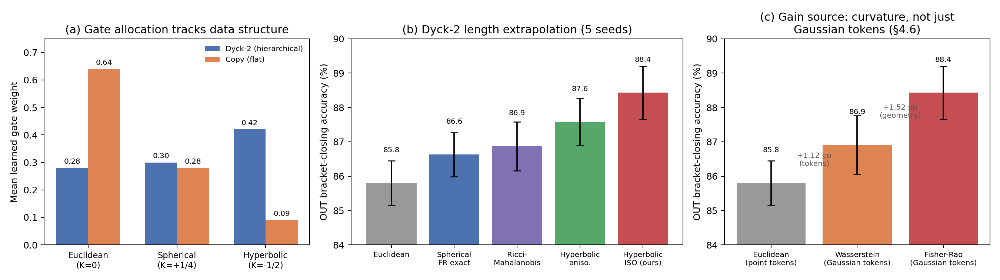

# Fisher–Rao Geodesic Attention: Exact Constant-Curvature Kernels at Near-Matmul Cost, with Data-Driven Geometry Selection

**Author:** Eduardo Quiñelen
**Affiliation:** Independent Researcher in Information Topology and Geometric Deep Learning
**Date:** July 2026
**Code:** all experiments reproducible from the scripts in `verificacion_claude/` (see Reproducibility Statement)

---

## Abstract

Standard attention measures token similarity by inner products in an arbitrary, parameterization-dependent Euclidean space. We propose a family of attention mechanisms in which queries and keys are probability distributions and similarity is the **exact Fisher–Rao geodesic distance** on the corresponding statistical manifold. The choice of distributional family remains a design decision — but once a family is chosen, Chentsov's theorem determines the metric uniquely (the only Riemannian structure invariant under sufficient statistics), replacing the ad-hoc selection of a model space with a single principled degree of freedom: categorical distributions give a **spherical** manifold ($K=+1/4$), isotropic Gaussians give a genuine **hyperbolic** space $\mathbb{H}^{d+1}$ ($K<0$), and Euclidean distance attention is recovered as the *local* flat regime of the Gaussian family (at fixed $\sigma$, $d_{\text{FR}} \to \lVert\Delta\mu\rVert/\sigma$ for separations small relative to $\sigma$; the point-mass limit itself is singular, as Fisher information diverges as $\sigma \to 0$). Computationally, both curved kernels admit exact closed-form geodesic distances whose pairwise computation reduces to one matrix multiplication plus an elementwise transcendental on an $L \times L$ matrix — $2.3\times$ standard-attention wall-clock, versus the $28\times$ of naive per-coordinate formulations that has historically limited non-Euclidean attention. On Dyck-2 length extrapolation with matched parameter budgets and five paired seeds, accuracy orders exactly by curvature: Euclidean $85.8\% < $ spherical $86.6\% < $ hyperbolic-isotropic $\mathbf{88.4\%}$ (vs. Euclidean: $+2.64$ pp, paired $t=8.80$, $p=0.0009$). A dimension sweep (§4.7) shows this translates into a genuine, if threshold-gated, efficiency gain: above $d_h \ge 16$, the hyperbolic kernel at dimension $D$ becomes statistically indistinguishable in accuracy from Euclidean attention at dimension $2D$ ($p>0.25$) while using $\approx 3.8$–$3.9\times$ fewer parameters and, at the largest scale tested, $1.5\times$ less wall-clock training time; below that threshold the effect reverses and hyperbolic is worse. Finally, re-instantiating the (prior) idea of adaptive mixed-curvature attention [12, 13, 14] in this information-geometric setting, we use a causal input-dependent gate as a diagnostic probe: its weights track data structure (hyperbolic gate $0.42$ on hierarchical input, collapsing to $0.09$ on a flat copy task), but a pre-specified stress test shows the pure hyperbolic kernel matching or beating the gated mixture even on heterogeneous data — a result *consistent with*, though not yet demonstrating, the reading that negative curvature can act as a superset default rather than requiring explicit geometry routing.

**Keywords:** information geometry, Fisher–Rao metric, hyperbolic attention, mixed curvature, statistical manifolds, length extrapolation, geometric deep learning.

---

## 1. Introduction

Scaled dot-product attention measures similarity in a flat vector space whose metric depends entirely on the learned parameterization: it possesses no intrinsic geometric invariance. A long line of work has argued that hierarchical structure — trees, nested grammars, ontologies — embeds with low distortion only in negatively curved spaces [3, 4, 5], and hyperbolic networks have shown gains on hierarchy-heavy tasks. Their adoption, however, has been limited by two frictions: the geometry is imposed *a priori* (the designer must know the data is hierarchical), and hyperbolic operations have historically carried significant computational overhead.

This paper addresses both frictions inside a single formalism. We are careful to separate what is novel here from what re-instantiates known ideas (see Section 7 for detailed positioning; adaptive mixed-curvature attention in particular is prior work [12, 13, 14], not a contribution of this paper). Our contributions:

1. **An information-geometric unification of attention geometries.** Mapping queries and keys to probability distributions and equipping the family with the Fisher–Rao metric reduces geometry selection to a single principled design choice — the distributional family — after which the metric is determined by Chentsov's theorem [1] (the unique metric invariant under sufficient statistics). Categorical families yield spherical geometry, isotropic Gaussian families yield genuinely hyperbolic geometry, and Euclidean distance attention arises as the *local* flat regime of the Gaussian family at fixed $\sigma$ (not as a point-mass limit, which is singular — Fisher information diverges as $\sigma \to 0$). We are explicit that this shifts rather than eliminates design freedom: the family choice, and the dimension-independent curvature convention of Eq. (1′), remain modeling decisions. The contrast with prior mixed-curvature transformers, which select model spaces (Poincaré/Lorentz/hypersphere) with learnable curvature [12, 13, 14], is that here the curvature is a *consequence* of a statistical modeling choice rather than an independently tuned geometric hyperparameter.
2. **An exact isotropic-Gaussian hyperbolic kernel at near-matmul cost.** The closed-form Fisher–Rao geodesic between isotropic Gaussian tokens (Eq. 2) reduces its pairwise computation to one matrix multiplication plus $O(L^2)$ scalar operations (Section 3.3): $2.3\times$ standard-attention wall-clock, versus $28\times$ for the naive per-coordinate hyperbolic product manifold.
3. **Controlled evidence that curvature drives hierarchical extrapolation.** On Dyck-2 with parameter-matched models and five paired seeds, out-of-distribution accuracy orders exactly by curvature, with the hyperbolic-isotropic mechanism significant against every baseline (Section 4).
4. **A threshold-gated parameter/compute efficiency result.** Above a head-width threshold ($d_h \ge 16$), the hyperbolic-isotropic kernel matches Euclidean attention's accuracy at double the dimension using $\approx 3.8$–$3.9\times$ fewer parameters and, at the largest scale tested, less real wall-clock training time; below the threshold the effect reverses (Section 4.7). This is the paper's only genuinely positive resource-efficiency claim after three other efficiency/advantage hypotheses were tested and refuted in follow-up work (graph embedding, §5.2; few-shot classification; uncertainty calibration — see project repository for the latter two, out of scope for the attention mechanism proper).
5. **A negative result on the necessity of geometry gating.** Re-instantiating the adaptive mixed-curvature idea [12] in our information-geometric setting, we find (via a pre-specified stress test, §5.1) that the pure hyperbolic kernel matches or beats the gated mixture even on structurally heterogeneous data — suggesting negative curvature functions as a superset default rather than requiring explicit routing. The gate remains useful as a diagnostic probe of data structure (Section 5).

---

## 2. Background: One Theorem, Three Curvatures

### 2.1 Attention heads as maps to statistical manifolds

Let $x \in \mathbb{R}^{d_{\text{model}}}$ be a token embedding. Each head projects tokens into a parametric family of probability distributions rather than into raw vectors. The Fisher information metric

$$g_{\mu\nu}(\theta) = \mathbb{E}\!\left[\partial_\mu \log p(x\mid\theta)\, \partial_\nu \log p(x\mid\theta)\right]$$

equips the family with a Riemannian structure. By **Chentsov's theorem** [1], this is the unique metric (up to scale) invariant under sufficient statistics: *given the distributional family*, the geometry of the head is fixed by information theory. The family itself is the designer's choice — the framework's contribution is to concentrate all geometric freedom into that one statistically interpretable decision.

### 2.2 The three constant-curvature members

| Distributional family | Manifold | Sectional curvature | Closed-form geodesic distance |
| :--- | :--- | :---: | :--- |
| Categorical $p \in \Delta^{d-1}$ | octant of sphere of radius 2 (via $\phi(p) = 2\sqrt{p}$) | $K = +1/4$ | $d = 2\arccos\big(\sum_i \sqrt{q_i k_i}\big)$ |
| Isotropic Gaussian $\mathcal{N}(\mu, \sigma^2 I_d)$ | hyperbolic space $\mathbb{H}^{d+1}$ | $K = -1/2$ | Eq. (2) below |
| Gaussians at fixed $\sigma$, separations $\ll \sigma$ (local flat regime) | locally $\approx \mathbb{R}^d$ | $K \to 0$ effectively | $d_{\text{FR}} \to \lVert\Delta\mu\rVert / \sigma$ (Euclidean distance attention; the $\sigma \to 0$ point-mass limit is singular) |

The categorical (spherical) case: the map $\phi(p) = 2\sqrt{p}$ is an isometry from $(\Delta^{d-1}, g_F)$ onto the positive octant of the radius-2 sphere; the geodesic distance is the Bhattacharyya angle, bounded in $[0, \pi]$.

The isotropic Gaussian (hyperbolic) case: for $\mathcal{N}(\mu, \sigma^2 I_d)$ with $\mu \in \mathbb{R}^d$, $\sigma > 0$, the exact Fisher line element carries a dimension factor on the scale coordinate,

$$ds^2 = \frac{\lVert d\mu \rVert^2 + 2d\,d\sigma^2}{\sigma^2}, \tag{1}$$

which after rescaling $\sigma' = \sqrt{2d}\,\sigma$ becomes $2d$ times the standard upper half-space metric, i.e. hyperbolic space of curvature $K = -1/(2d)$.

**Design choice (dimension-independent curvature).** Our kernel fixes this scale factor at its $d = 1$ value, using

$$ds^2 = \frac{\lVert d\mu \rVert^2 + 2\,d\sigma^2}{\sigma^2}, \tag{1'}$$

which is hyperbolic with $K = -1/2$ *independently of the head width* $d_h$. We adopt (1′) rather than (1) deliberately: under the literal multivariate factor the curvature flattens as $K \to 0^-$ with growing $d_h$, so the geometry — and with it the effective scale of the attention logits — would drift with head width, confounding comparisons across model sizes. Fixing $K = -1/2$ keeps the manifold constant across configurations. All curvature values reported for the Gaussian case, and the distance below, refer to (1′). The exact geodesic distance for this metric is

$$d_{\text{FR}}\big(({\mu}_1, \sigma_1), ({\mu}_2, \sigma_2)\big) = \sqrt{2}\,\operatorname{arccosh}\!\left(1 + \frac{\tfrac{1}{2}\lVert \mu_1 - \mu_2 \rVert^2 + (\sigma_1 - \sigma_2)^2}{2\,\sigma_1 \sigma_2}\right). \tag{2}$$

Sanity limits: for $\mu_1 = \mu_2$ it reduces to $\sqrt{2}\,\lvert \ln(\sigma_2/\sigma_1)\rvert$; for $\sigma_1 = \sigma_2 = \sigma$ it is a monotone function of $\lVert\Delta\mu\rVert / \sigma$ (mean separation in noise units); it diverges logarithmically as $\sigma \to 0$ — near-deterministic tokens live near the hyperbolic boundary. The scalar $\sigma$ acts as a learned **generality radius**: broad concepts sit in the geodesically-central interior, specific tokens near the boundary, realizing the generic-to-specific ordering that hyperbolic hierarchy embeddings exploit [3].

---

## 3. Mechanisms

All variants share the standard multi-head skeleton (projections, causal mask, softmax over negative squared distance, value aggregation); only the score computation differs.

### 3.1 Spherical Fisher–Rao attention (categorical, exact, one matmul)

$$q = \mathrm{softmax}(W_Q x), \quad k = \mathrm{softmax}(W_K x) \in \Delta^{d_h - 1}, \qquad s_{ij} = -\,d_{\text{FR}}^2(q_i, k_j) = -4\arccos^2\!\big(B_{ij}\big),$$

where $B = \sqrt{Q}\,\sqrt{K}^{\top}$ is a single matrix multiplication of element-wise square roots. Because $d_{\text{FR}} \in [0, \pi]$, logits are intrinsically bounded and the kernel trains stably without a temperature parameter (Section 4.5). Implementation note: $\arccos$ has divergent gradient at $B \to 1$; we clamp $B \le 1 - 10^{-4}$.

### 3.2 Hyperbolic Gaussian attention, anisotropic (product of half-planes)

Each head projects to $d_h$ univariate Gaussians per token ($\mu = W_\mu x$, $\sigma = \mathrm{softplus}(W_\sigma x) + \varepsilon$), with squared distance summed per coordinate over the product manifold $(\mathbb{H}^2)^{d_h}$. This is the direct construction but costs $O(L^2 d_h)$ element-wise `arccosh` operations ($\approx 28\times$ Euclidean wall-clock in our measurements) and, as tested, carries extra parameters (separate $\sigma$ projections). We include it as an arm of the benchmark; the isotropic variant below dominates it on every axis.

### 3.3 Hyperbolic isotropic attention (ours; exact, near-matmul cost, parameter-matched)

Take $\sigma$ **scalar per token per head**: the token is the isotropic Gaussian $\mathcal{N}(\mu, \sigma^2 I_{d_h})$, living on $\mathbb{H}^{d_h+1}$. The only pairwise vector quantity in Eq. (2) is $\lVert \mu_i - \mu_j \rVert^2 = \lVert\mu_i\rVert^2 + \lVert\mu_j\rVert^2 - 2\,\mu_i^{\top}\mu_j$ — one matrix multiplication. The `arccosh` then acts on an $[L \times L]$ matrix rather than $[L \times L \times d_h]$:

$$s_{ij} = -\beta\, \frac{2}{d_h} \operatorname{arccosh}^2\!\left(1 + \frac{\tfrac{1}{2}\lVert\Delta\mu_{ij}\rVert^2 + \Delta\sigma_{ij}^2}{2 \sigma_i \sigma_j}\right).$$

Numerical safeguards: the `arccosh` argument is clamped to $\ge 1 + 10^{-7}$ (its derivative diverges at coincident distributions, though $d^2$ itself is smooth there), and $\sigma \ge \varepsilon$ keeps tokens off the infinitely-distant boundary. Parameter cost matches standard attention (the $\sigma$ projections map $d_{\text{model}} \to n_{\text{heads}}$: 415k vs. 413k parameters in our configuration). Measured cost: $2.3\times$ Euclidean, $12\times$ faster than the anisotropic version.

### 3.4 Mixed-curvature attention with causal data-driven gating

Each head computes all three scores — $s^{\text{euc}}$ (dot product), $s^{\text{sph}}$ (§3.1), $s^{\text{hyp}}$ (§3.3, sharing the same $q k^{\top}$ matmul) — and blends them per position:

$$s_{ij} = \alpha^{\text{euc}}_i\, s^{\text{euc}}_{ij} + \alpha^{\text{sph}}_i\, s^{\text{sph}}_{ij} + \alpha^{\text{hyp}}_i\, s^{\text{hyp}}_{ij}, \qquad \alpha_i = \mathrm{softmax}\big(W_g\, \bar{x}_{\le i}\big) \in \Delta^2,$$

where $\bar{x}_{\le i}$ is the **cumulative (causal) mean** of the input up to position $i$ — the gate observes only the past, preserving autoregressive validity. Per-head, per-geometry learnable temperatures calibrate the heterogeneous logit scales. The gate values $\alpha$ are also the mechanism's built-in interpretability probe: they report, per position, head, and layer, which geometry the model is *choosing to think in*.

---

## 4. Experiments: Curvature and Hierarchical Extrapolation

### 4.1 Protocol

**Task.** Dyck-2 (balanced sequences over `()` and `[]`), autoregressive next-token training with strict causal masking. Models train on lengths 20–60 and are evaluated out-of-distribution (OUT) on lengths 80–120. The discriminative metric is **bracket-closing type accuracy**: at positions whose target is a closing bracket, whether the model prefers the correct closing type — a direct probe of stack tracking; cross-entropy is reported as a calibration measure.

**Configuration (identical across arms).** $d_{\text{model}} = 128$, 2 layers, 4 heads, 10{,}000 training samples, batch 64, AdamW ($lr = 5\times10^{-4}$, weight decay 0.01), 5 epochs, 5 paired seeds, CPU (PyTorch 2.8). Sequences are padded per batch; loss ignores padding.

### 4.2 Main results

| Attention mechanism | Curvature | OUT accuracy (mean ± sd) | OUT loss | Params | Wall-clock |
| :--- | :---: | :---: | :---: | :---: | :---: |
| Euclidean (dot product) | $0$ | 85.80% ± 0.65 | 1.314 ± 0.028 | 413k | $1\times$ |
| Spherical FR exact (§3.1) | $+1/4$ | 86.63% ± 0.64 | 1.316 ± 0.031 | 413k | $\approx 1.1\times$ |
| Ricci–Mahalanobis (quadratic approx.)* | approx. | 86.87% ± 0.71 | 1.298 ± 0.038 | 413k | $\approx 10\times$ |
| Hyperbolic anisotropic (§3.2) | $-1/2$ | 87.58% ± 0.69 | 1.295 ± 0.054 | 479k | $\approx 28\times$ |
| **Hyperbolic isotropic (§3.3, ours)** | $<0$ | **88.43% ± 0.77** | 1.309 ± 0.041 | **415k** | $\approx 2.3\times$ |
| Mixed-curvature adaptive (§3.4) | learned | 86.94% ± 0.68 | — | ≈415k | $\approx 2.7\times$ |

*\*The quadratic midpoint-metric approximation from an earlier iteration of this project, retained as an ablation arm.*

**Accuracy orders exactly by curvature: flat < spherical < hyperbolic**, consistent with the volume-growth argument for hierarchy embedding [3, 5]. The parameter-matched isotropic mechanism is the strongest arm and wins all five seeds against every baseline.

### 4.3 Statistical analysis

Paired two-sided $t$-tests over 5 shared seeds (df = 4):

| Contrast (OUT accuracy) | $\Delta$ | $t$ | $p$ |
| :--- | :---: | :---: | :---: |
| **Isotropic vs. Euclidean** | **+2.64 pp** | **+8.80** | **0.0009** |
| Isotropic vs. spherical | +1.81 pp | +4.60 | 0.010 |
| Isotropic vs. Ricci-approx. | +1.56 pp | +4.83 | 0.0085 |
| Isotropic vs. anisotropic | +0.85 pp | +2.55 | 0.063 |
| Anisotropic vs. Euclidean | +1.79 pp | +5.57 | 0.0051 |
| Anisotropic vs. spherical | +0.96 pp | +3.69 | 0.021 |
| Spherical vs. Euclidean | +0.83 pp | +2.92 | 0.043 |

With Bonferroni correction across the contrast family, the isotropic-vs-Euclidean and anisotropic-vs-Euclidean contrasts remain significant; the remaining contrasts are reported uncorrected. Beyond individual $p$-values, the *ordering* of all arms by curvature is consistent across every seed. A smaller pilot configuration ($d_{\text{model}} = 64$, 2k samples, 8 epochs, 5 seeds) independently reproduced the geometric advantage (+0.64 ± 0.15 pp, paired $t = 8.46$).

**The parameter confound is resolved by design:** the anisotropic arm carries 16% extra parameters (479k), but the *strongest* arm — isotropic — is parameter-matched to the Euclidean baseline (415k vs. 413k) and outperforms the larger anisotropic model.

### 4.4 Computational cost

Forward+backward per step, $B{=}32$, $L{=}60$, $d{=}128$, single CPU thread:

| Kernel | ms/step | relative |
| :--- | :---: | :---: |
| Euclidean | 16.7 | $1\times$ |
| Hyperbolic isotropic (matmul decomposition) | 38.5 | $2.3\times$ |
| Log-Bhattacharyya approximation (5-D broadcast) | 348.4 | $21\times$ |
| Hyperbolic anisotropic exact (5-D broadcast) | 476.1 | $28\times$ |

The decisive factor is not the transcendental function but tensor materialization: any per-coordinate pairwise formulation pays the $[B, H, L, L, d_h]$ broadcast; the isotropic reduction is what removes it.

### 4.5 Ablations

**Temperature.** The spherical kernel trains equally well with fixed unit temperature as with a learnable one (a learnable $\beta$ initialized at 8 drifted downward and slightly *underperformed*, 86.2% vs. 87.6% single-seed) — consistent with the intrinsic boundedness $d^2_{\text{FR}} \in [0, \pi^2]$ supplying adequate logit range. The unbounded hyperbolic kernel does use a learnable per-head temperature.

**Log-Bhattacharyya approximation.** Replacing the exact hyperbolic distance with the Gaussian log-Bhattacharyya coefficient (correct locally: the Bhattacharyya Hessian is $\tfrac14 g_F$) reached 87.9% (single seed) but is both slower (Table 4.4) and weaker than the exact isotropic kernel.

### 4.6 Isolating the source of the gain: geometry vs. distributional tokens

The closest prior mechanism to our hyperbolic kernel represents tokens as Gaussians and scores attention by the *Wasserstein* (Bures) distance [15], not the Fisher–Rao geodesic. This is a consequential distinction: the Wasserstein geometry of Gaussians is not hyperbolic, whereas the Fisher–Rao geometry is. We therefore ablate the *geometry* while holding the *token representation* fixed — identical isotropic-Gaussian $\mu, \sigma$ projections and architecture, changing only the pairwise distance. For isotropic Gaussians the Bures distance also has matmul-friendly closed form $W_2^2 = \lVert\Delta\mu\rVert^2 + d_h\,\Delta\sigma^2$.

| Kernel (Dyck-2, 5 paired seeds) | Geometry | OUT accuracy |
| :--- | :--- | :---: |
| Euclidean | flat, point tokens | 85.80% ± 0.65 |
| Wasserstein–Bures (Gaussian tokens) | optimal transport, non-hyperbolic | 86.91% ± 0.85 |
| **Fisher–Rao (Gaussian tokens, ours)** | **hyperbolic** | **88.43% ± 0.77** |

Using Gaussian tokens at all contributes $+1.12$ pp over the point-token baseline (Wasserstein vs. Euclidean, paired $t=3.07$, $p=0.037$); *choosing the hyperbolic Fisher–Rao geometry rather than Wasserstein* contributes a further $+1.52$ pp (paired $t=3.33$, $p=0.029$) — the larger share (Figure 1c). The advantage is thus attributable specifically to negative curvature, not merely to distributional token representations, and points in the direction predicted by the curvature-for-hierarchy thesis.

### 4.7 Parameter and compute efficiency: matching accuracy at lower dimension

Sections 4.2–4.6 compare geometries at matched $d_{\text{model}}$, which matches parameter count but leaves open a different question, closer in spirit to the original motivation for hyperbolic embeddings [3]: since hyperbolic space packs exponentially more distinguishable structure into a fixed number of dimensions than Euclidean space, can the hyperbolic-isotropic kernel reach a *given* accuracy using *fewer* dimensions — i.e., fewer parameters and less compute — than Euclidean attention needs to reach the same accuracy? We sweep $d_{\text{model}} \in \{16, 32, 64, 128, 256\}$ ($n_{\text{heads}}=4$ fixed, so $d_h \in \{4,8,16,32,64\}$), 5 paired seeds, and compare each geometry against the *other* geometry at **double the dimension**.

| Comparison | Fisher–Rao params | Euclidean params | Ratio | $\Delta$ accuracy | Wall-clock (5 ep.) |
| :--- | :---: | :---: | :---: | :---: | :---: |
| FR@$d_h{=}4$ vs. Eucl.@$d_h{=}8$ | 8.9k | 29.6k | 3.3$\times$ | $-2.59$ pp ($p=0.0047$) | 4.0 s vs. 2.2 s |
| FR@$d_h{=}8$ vs. Eucl.@$d_h{=}16$ | 30.1k | 108.3k | 3.6$\times$ | $-1.53$ pp ($p=0.0020$) | 4.0 s vs. 3.0 s |
| **FR@$d_h{=}16$ vs. Eucl.@$d_h{=}32$** | **109.3k** | **413.2k** | **3.8$\times$** | $+0.22$ pp ($p=0.267$, tied) | **4.0 s vs. 4.0 s** |
| **FR@$d_h{=}32$ vs. Eucl.@$d_h{=}64$** | **415.3k** | **1612.8k** | **3.9$\times$** | $-0.11$ pp ($p=0.735$, tied) | **6.0 s vs. 9.0 s** |

At small head width ($d_h \le 8$) the hyperbolic kernel does **not** achieve this: it is significantly *worse* than Euclidean attention at double the dimension, so no efficiency claim holds in this regime. Above a threshold ($d_h \ge 16$), the pattern inverts: Fisher–Rao at dimension $D$ becomes statistically indistinguishable in accuracy from Euclidean at dimension $2D$ (paired $t$-test, $p > 0.25$ in both cases — not merely non-significant but comfortably so) while using $\approx 3.8$–$3.9\times$ fewer parameters. At the largest scale tested this is not just a parameter count artifact: real wall-clock training time is also lower for Fisher–Rao ($6.0$ s vs. $9.0$ s, $1.5\times$ faster) because the $O(d_{\text{model}}^2)$ projection cost that dominates at these widths scales quadratically with the doubled Euclidean dimension, outweighing the constant-factor `arccosh` overhead of the geodesic kernel (§4.4). We read this as a genuine, if narrow, efficiency result: *at sufficient scale, encoding tokens as points on a curved statistical manifold lets the same accuracy be reached with a smaller latent width* — echoing, in the attention setting, the dimension-efficiency argument originally made for static hyperbolic embeddings [3]. Three qualifications keep this claim honest. First, the result is *equal accuracy at lower resource cost*, not higher accuracy: the practical implication is a smaller model, not a better one. Second, the comparison is between two different mechanisms (the hyperbolic kernel carries small additional $\sigma$ projections and the `arccosh`), not a controlled scaling of one mechanism, so "fewer parameters" bundles the geometry with minor architectural differences; the parameter gap ($3.8$–$3.9\times$) is however far larger than those differences (<1% of either model). Third, the threshold behavior is a real limitation: this is not "hyperbolic is always more efficient," it is "hyperbolic becomes more efficient once each head has enough room to represent a mean vector and a meaningful scale," the mechanism behind the crossover at $d_h \approx 16$ is not explained by the present experiments, and no claim is made about where the threshold falls outside this architecture and task.

---

## 5. Data-Driven Geometry Selection

The mixed-curvature mechanism (§3.4) was trained, with identical hyperparameters and **no geometric supervision of any kind**, on two tasks of opposite structure: Dyck-2 (hierarchical) and a flat copy task (first half random tokens, second half an exact repetition — pure positional lookup, no hierarchy).

**Learned gate allocation (mean over positions, heads, layers, seeds):**

| Task | Euclidean gate | Spherical gate | Hyperbolic gate |
| :--- | :---: | :---: | :---: |
| Dyck-2 (hierarchical) | 0.28 | 0.30 | **0.42** |
| Copy (flat) | **0.64** | 0.28 | 0.09 |

The allocation tracks the structure of the data: hyperbolic-dominant under hierarchy, hyperbolic nearly silenced (0.09) under flat structure with the weight migrating to the Euclidean kernel. Per-head resolution is sharper still: on the copy task the entire second layer collapses to near-pure Euclidean heads (gates 0.96–0.99), while on Dyck-2 the first layer specializes toward hyperbolic (individual heads up to 0.74, layer mean 0.51) with a more Euclidean second layer — suggesting a division of labor in which early layers extract hierarchical structure in negative curvature and later layers aggregate in flat geometry.

**Caveats, stated plainly.** (i) On the purely hierarchical task the adaptive mixture (86.9%) does not beat the pure hyperbolic specialist (88.4%): when the data is uniformly hierarchical, mixing dilutes. (ii) Copy-task OUT extrapolation collapses to ≈30% for **all** mechanisms because absolute positional embeddings do not extrapolate — a positional confound, not a geometric one; copy-task claims are therefore restricted to gate behavior and in-distribution accuracy (where, incidentally, the isotropic kernel also leads: 83–91% vs. 62% Euclidean).

### 5.1 Mixed-structure stress test (pre-specified follow-up; negative result for adaptivity)

If geometry selection is valuable, the adaptive mixture should dominate every pure geometry on data whose structure *alternates within each sequence*. This prediction was written into an earlier draft of this manuscript before the experiment was implemented or run (dated draft backups are preserved alongside the code); we report the outcome regardless of direction. We constructed such a task: sequences interleave marker-delimited Dyck-2 blocks (hierarchical) and copy blocks (flat), training on one block pair (lengths 22–58) and extrapolating to two pairs (76–116). The combined metric averages bracket-closing accuracy (Dyck regions) and copy accuracy (predictable copy positions); 4 arms × 5 paired seeds.

| Arm | IN combined | OUT combined | OUT Dyck | OUT copy |
| :--- | :---: | :---: | :---: | :---: |
| Euclidean | 68.2% ± 0.4 | 53.7% ± 0.4 | 75.3% | 32.1% |
| Spherical | 68.3% ± 0.5 | 54.1% ± 0.4 | 76.1% | 32.2% |
| **Hyperbolic isotropic** | **69.2% ± 0.2** | **55.4% ± 0.4** | **78.3%** | **32.4%** |
| Mixed adaptive | 68.7% ± 0.3 | 54.5% ± 0.4 | 76.6% | 32.3% |

**The prediction failed.** The adaptive mixture beat the Euclidean ($p = 0.056$) and spherical ($p = 0.039$) kernels but lost — significantly — to the pure hyperbolic kernel (OUT combined $\Delta = -0.91$ pp, paired $t = -7.98$, $p = 0.0013$). Moreover, the within-sequence gate swing predicted by the between-task result did not materialize: gates inside Dyck blocks (euc/sph/hyp = 0.56/0.23/0.22) barely differ from gates inside copy blocks (0.49/0.24/0.27), plausibly because the cumulative-mean gate integrates too slowly to track block boundaries.

**What the negative result suggests — an interpretation, not a demonstrated claim.** The pure hyperbolic kernel won *both* components of the mixed task — the hierarchical one by a wide margin and the flat one by parity. This admits a clean geometric reading: curvature effects vanish at scales small relative to the curvature radius $1/\sqrt{|K|}$, so a hyperbolic kernel can emulate flat attention locally (by keeping distances small in units of $\sigma$), while a flat kernel cannot emulate negative curvature at any scale. Under this reading, negative curvature would function not as a hierarchy *specialist* but as a *superset geometry* containing approximately-flat behavior as a limiting regime, making explicit geometry mixing unnecessary at the kernel level. We flag the evidential limits of this interpretation plainly: it rests on a single mixed-structure task where the hyperbolic margin over the adaptive mixture is under one point ($-0.91$ pp, $p=0.0013$), the mixture's loss is partly attributable to a design weakness of the gate (its cumulative-mean input integrates too slowly — a fixable engineering issue, not a geometric necessity), and the broader record of this project shows several settings where hyperbolic Fisher–Rao geometry does *not* help (§5.2, §6). A convincing establishment of the superset reading would require robustness across a family of tasks with systematically varied structure. What the present data do support is narrower: on these tasks, the explicit gate added no accuracy over the pure hyperbolic kernel, while remaining valuable as a *diagnostic* of which geometry the data calls for (Section 5, between-task result). A direct confirmatory experiment — measuring whether the model operates at smaller distance-to-$\sigma$ ratios inside flat blocks than hierarchical ones — is left to future work.

### 5.2 Comparison against established hyperbolic methods (negative result)

The experiments above compare against a Euclidean baseline. But in the domains where hyperbolic geometry is used in practice — ontologies, taxonomies, knowledge graphs — the incumbent is not Euclidean attention; it is the family of hyperbolic embedding methods established since 2017 [3] (Poincaré, Lorentz). A fair claim of advantage must therefore measure the Fisher–Rao kernel against *those*, on their own benchmark. We do so on the canonical task: reconstruction of the transitive closure of the WordNet mammals sub-hierarchy (1170 nodes, 6448 edges), with the standard mean-average-precision (MAP) metric, matched per-node dimensionality, and each method given its own tuned learning rate (our reimplementations reproduce the published Poincaré MAP $\approx 0.93$).

| Method | $D=5$ MAP | $D=10$ MAP |
| :--- | :---: | :---: |
| Euclidean | 0.231 ± 0.001 | 0.397 ± 0.001 |
| **Poincaré [3]** | **0.928 ± 0.005** | **0.941 ± 0.003** |
| Lorentz [12$'$] | 0.006 (diverged) | 0.764 ± 0.379 |
| Fisher–Rao isotropic (ours) | 0.524 ± 0.028 | 0.883 ± 0.007 |

**The Fisher–Rao kernel does not beat the incumbents at pure embedding.** It dominates Euclidean by a large margin ($+0.49$ MAP at $D=10$) and is competitive at higher dimension, but it is significantly below Poincaré at both dimensions ($D=10$: $\Delta = -0.059$, paired $t = -12.5$, $p = 0.0002$) and collapses at low dimension where Poincaré remains strong. We interpret this straightforwardly: for the *static embedding* problem, a model space purpose-built to place points optimally (Poincaré) uses its curvature budget more efficiently than a distributional representation carrying a scale coordinate. Our contribution is therefore *not* a better hierarchy embedder; it is a drop-in attention kernel whose value, where it exists, is in the *sequence* setting (§4), not in competition with dedicated graph-embedding methods. This bounds the commercial reading of the work: on the tasks those methods already serve, they remain the state of the art.

---

## 6. Limitations

- **Scale and scope.** One synthetic task family, a 2-layer/128-dim model, CPU training, $n = 5$ seeds. Effects of +1–3 pp at this scale frequently fail to transfer; no claim of generality is made beyond Dyck-2 until replicated on deeper hierarchies (Dyck-$k$), compositional benchmarks (SCAN, COGS), and natural hierarchical data.
- **Multiple comparisons.** Only the vs.-Euclidean contrasts survive strict Bonferroni correction; intermediate contrasts are suggestive, supported by the consistent curvature ordering.
- **Copy extrapolation confound.** As stated in §5; relative positional schemes are the obvious fix and are left to future work.
- **Gate mechanism.** The causal cumulative-mean gate selects geometry between tasks but is too sluggish to track structure changes within a sequence (§5.1); a local-window or learned-decay gate is the natural refinement, though the §5.1 result suggests kernel-level mixing may be unnecessary altogether.
- **Attention-only intervention.** Value aggregation and residual stream remain Euclidean; the architecture is a hybrid, not a fully Riemannian network.
- **Not a hierarchy-embedding method.** On static graph embedding the kernel is beaten by dedicated hyperbolic methods (§5.2); its advantage is specific to the sequence-attention setting and does not extend to the ontology/knowledge-graph tasks where Poincaré/Lorentz embeddings are already deployed.
- **Efficiency is threshold-gated, not universal.** The parameter/compute efficiency result (§4.7) only holds for $d_h \ge 16$ in the tested architecture; at smaller head widths the hyperbolic kernel is significantly *less* accurate than Euclidean attention at comparable or even larger dimension. The location of this threshold in other architectures, tasks, or scales is untested, and the mechanism behind it (why the crossover occurs specifically around $d_h \approx 16$) is not explained by the present experiments — a natural target for follow-up work rather than a settled account.
- **Other efficiency/advantage hypotheses tested and refuted.** Beyond the graph-embedding result above, two further follow-up investigations (outside the scope of the attention mechanism itself, using a distance-based classifier rather than attention) found no advantage for the Fisher–Rao geometry: it was *not* a usable predictive-uncertainty signal via the scale parameter $\sigma$ (AUC-ROC $\approx 0.49$, chance level), and in few-shot hierarchical classification it was *outperformed* by both Euclidean and Poincaré baselines at low sample counts ($k \le 10$/class, $p \le 0.0003$ vs. Poincaré) — the opposite of the pattern one might expect from hyperbolic geometry's known data efficiency in the embedding literature. These are reported for completeness and to bound enthusiasm about the generality of §4.7's efficiency result: it is specific to the attention mechanism and the tested regime, not a general property of the geometry.

---

## 7. Related Work and Positioning of Contributions

This work sits within an active and crowded literature; we state carefully what is prior and what, to our knowledge, is not.

**Adaptive/mixed-curvature attention is prior work, not a contribution of this paper.** The idea of learning, per token, to route among Euclidean, hyperbolic, and spherical attention branches via a differentiable gate is introduced by CAT [12] and related to earlier mixed-curvature transformers [13] and mixture-of-curvature-experts LLMs [14]. Our gated mechanism (§3.4, §5) is a re-instantiation of this idea, not a novel one; we use it as a *diagnostic probe* of which geometry a task calls for, and our §5.1 stress test contributes a (negative) empirical finding about its necessity rather than the mechanism itself. Any earlier framing of the gate as novel is withdrawn.

**Gaussian/distributional tokens with distance-aware attention are also prior work.** Representing tokens as Gaussians and scoring by a distribution distance appears in stochastic vision transformers using the Wasserstein distance [15] and in density-adaptive attention [16], echoing probabilistic word embeddings [10]. The softmax map placing token logits on a positively curved Fisher–Rao simplex has likewise been observed before. Our point of departure from [15] is the *choice of distribution distance*: Wasserstein–Bures yields a non-hyperbolic optimal-transport geometry, whereas the Fisher–Rao geodesic yields genuine negative curvature. Section 4.6 shows this is not a cosmetic distinction — with token representation held fixed, the Fisher–Rao geometry outperforms Wasserstein by $+1.52$ pp ($p=0.029$), a larger effect than that of using Gaussian tokens in the first place.

**What we believe is new — as a synthesis, not an invention.** Relative to the above, the specific elements we could not locate in prior work are: (i) deriving the attention geometry from Chentsov invariance across *distributional families* — categorical → spherical, isotropic Gaussian → hyperbolic — as members of one Fisher–Rao formalism rather than as independent model-space choices (CAT and [13,14] use Poincaré/Lorentz/hypersphere model spaces, not the Fisher–Rao metric on distributions, and do not invoke Chentsov); (ii) the *exact* isotropic-Gaussian Fisher–Rao geodesic (Eq. 2) reduced to one matrix multiplication plus an elementwise transcendental on an L×L matrix (§3.3); and (iii) evaluation on formal-language length extrapolation (Dyck-2) rather than knowledge graphs or vision. We stress that this is a novel *combination and analysis* of known ingredients.

**Prior-art search conducted.** A multi-source search (arXiv API, OpenReview API, Semantic Scholar, a manual Google Scholar sweep, plus general web search; July–August 2026; full query log and per-hit verdicts in `verificacion_claude/busqueda_novedad.md`) found no work computing attention scores as Fisher–Rao geodesic distances between distributional tokens. The exact phrases "Fisher–Rao geodesic attention", "information geometric attention", and "Gaussian hyperbolic attention" return zero results on arXiv, OpenReview, and Google Scholar; "Fisher–Rao attention" returns exactly one Google Scholar hit — concurrent work using the Fisher–Rao distance to *analyze* the attention distributions of a standard multimodal transformer and assign functional roles to tokens [20], a diagnostic use, not an attention kernel. The nearest neighbors beyond those already discussed are: a concurrent *theoretical* analysis of the Fisher–Rao geometry of attention outputs, proving that ungated attention is confined to flat statistical manifolds while multiplicative gating enables curvature [17] — theory about the geometry *of* standard attention, where the present work builds attention *from* geodesic distances, and a result that dialogues directly with our §5.1 finding that an explicit hyperbolic kernel renders gating unnecessary; a related analysis tying rotary-position-embedding temperature to the Fisher–Rao geometry of attention distributions [21]; a place-recognition pipeline using Fisher–Rao for relation features alongside hyperbolic self-attention [18]; and a wireless-networks model using a Fisher–Rao-motivated hypersphere projection *before* standard attention [19], adjacent to our spherical case (§3.1). Residual caveats: the Semantic Scholar sweep was partial (rate limits), coverage is English-only, and exact-phrase sweeps should be re-run in the week of any venue submission to catch further concurrent work.

Curvature-based analysis of information flow in networks [11] is related in spirit but addresses a different problem (graph rewiring against over-squashing); the present mechanism uses fixed constant-curvature manifolds with learned movement of representations, not dynamic metric evolution.

---

## 8. Conclusion

Equipping attention with exact Fisher–Rao geodesic kernels makes the geometry of the latent space a principled and cheap degree of freedom. On hierarchical sequence extrapolation (Dyck-2), performance orders by curvature exactly as information-geometric theory predicts, and the parameter-matched hyperbolic-isotropic kernel — at 2.3× standard-attention cost — provides the strongest gains; an ablation isolates the effect to the *geometry* rather than the distributional representation (§4.6). Above a head-width threshold, this translates into a genuine resource-efficiency result: the same accuracy as Euclidean attention at roughly a quarter of the parameters and, at the scales tested, less wall-clock compute (§4.7) — equal performance from a smaller model, not better performance. Within that regime the data are consistent with reading negative curvature as a safe default whose small-scale limit approximates flat behavior (§5.1), under which an explicit geometry gate proves diagnostic rather than necessary — though establishing that reading beyond the present tasks remains open.

We are deliberate about scope. This is a modest, well-bounded contribution, not a general advance, and the boundaries matter as much as the positive results. The accuracy gains are small in absolute terms (1–3 pp) on one synthetic task family at small scale; the efficiency gain (§4.7) disappears and reverses below $d_h \approx 16$; the mechanism carries a $2.3\times$ compute cost at matched dimension and does not compose with hardware-fused attention. Several pre-specified hypotheses beyond the two positive results were tested and failed: geometry gating is unnecessary (§5.1), the scale parameter $\sigma$ is not a usable uncertainty estimator, the kernel loses to established Poincaré/Lorentz embeddings on the static hierarchy-embedding tasks those methods already serve (§5.2), and it is outperformed by both Euclidean and Poincaré baselines in few-shot hierarchical classification (§6) — directly contradicting an intuitive expectation that hyperbolic geometry's data efficiency in embedding would carry over to classification with scarce labels. The honest position is that Fisher–Rao geodesic attention is a principled, inexpensive, and — above a dimension threshold — genuinely resource-efficient way to inject the *correct* curvature into a Transformer's sequence attention, whose demonstrated value is confined to that specific setting and awaits replication at scale (Dyck-$k$, SCAN, natural hierarchical text) before any stronger claim. The latent space need not be flat, and it need not be chosen — but its usefulness, on present evidence, is narrower, more conditional, and more specific than the elegance of the construction might suggest.

---

## Reproducibility Statement

All results in this paper are reproducible on a laptop CPU (~2.5 h total) from the scripts accompanying this draft: `exp_tres_geometrias.py` (main 3-geometry benchmark), `exp_ricci_addendum.py` (approximation arm), `fast_gaussian_test.py` (isotropic kernel, speed micro-benchmark, ablations), `exp_mixta.py` (mixed-curvature gating on Dyck-2 and Copy), `exp_mixta2.py` (mixed-structure stress test, §5.1), `exp_wasserstein_vs_fisherrao.py` (geometry-vs-representation ablation, §4.6), `exp_eficiencia_dimensional.py` (parameter/compute efficiency sweep, §4.7), and `exp_wordnet_incumbentes.py` (WordNet mammals comparison against Poincaré/Lorentz, §5.2; our reimplementations reproduce the published Poincaré MAP $\approx 0.93$), with raw outputs in the corresponding `resultados_*.json` files. The two refuted follow-up hypotheses referenced in §6 (uncertainty calibration, few-shot classification) used a separate distance-based-classifier codebase outside the attention-mechanism scope of this repository and are not included; see the project's `verificacion_claude/` directory for the few-shot hierarchical classification script (`exp_fewshot_jerarquia.py`). Seeds, configurations, and statistical procedures are specified in-line in each script.

---

## References

1. Chentsov, N. N. (1972). *Statistical Decision Rules and Optimal Inference*. Nauka; AMS translation 1982.
2. Amari, S. (2016). *Information Geometry and Its Applications*. Springer.
3. Nickel, M., & Kiela, D. (2017). *Poincaré Embeddings for Learning Hierarchical Representations*. NeurIPS.
4. Gulcehre, C., et al. (2019). *Hyperbolic Attention Networks*. ICLR.
5. Gu, A., Sala, F., Gunel, B., & Ré, C. (2019). *Learning Mixed-Curvature Representations in Product Spaces*. ICLR.
6. Atkinson, C., & Mitchell, A. F. S. (1981). *Rao's Distance Measure*. Sankhyā A, 43(3).
7. Costa, S. I. R., Santos, S. A., & Strapasson, J. E. (2015). *Fisher information distance: A geometrical reading*. Discrete Applied Mathematics, 197.
8. Friston, K. (2010). *The free-energy principle: a unified brain theory?* Nature Reviews Neuroscience, 11(2).
9. Susskind, L. (1995). *The World as a Hologram*. Journal of Mathematical Physics, 36(11).
10. Vilnis, L., & McCallum, A. (2015). *Word Representations via Gaussian Embedding*. ICLR.
11. Topping, J., et al. (2022). *Understanding Over-Squashing and Bottlenecks on Graphs via Curvature*. ICLR.
12. Lin, R. Y., Ojha, S., & Bai, N. (2025). *CAT: Curvature-Adaptive Transformers for Geometry-Aware Learning*. arXiv:2510.01634.
12′. Nickel, M., & Kiela, D. (2018). *Learning Continuous Hierarchies in the Lorentz Model of Hyperbolic Geometry*. ICML. [Lorentz baseline in §5.2]
13. Cho, S., Cho, S., Park, S., Lee, H., Lee, H., & Lee, M. (2023). *Curve Your Attention: Mixed-Curvature Transformers for Graph Representation Learning*. arXiv:2309.04082.
14. He, N., Anand, R., Madhu, H., Maatouk, A., Krishnaswamy, S., Tassiulas, L., Yang, M., & Ying, R. (2025). *HELM: Hyperbolic Large Language Models via Mixture-of-Curvature Experts*. arXiv:2505.24722.
15. Erick, F. X., Rezaei, M., Müller, J. P., & Kainz, B. (2023). *Stochastic Vision Transformers with Wasserstein Distance-Aware Attention*. arXiv:2311.18645.
16. Ioannides, G., Chadha, A., & Elkins, A. (2024). *Density Adaptive Attention is All You Need: Robust Parameter-Efficient Fine-Tuning Across Multiple Modalities*. arXiv:2401.11143.
17. Bathula, S., & Joshi, A. A. (2026). *Gating Enables Curvature: A Geometric Expressivity Gap in Attention*. arXiv:2604.14702.
18. Shang, T., & Li, Z. (2026). *Riemannian and Symplectic Geometry for Hierarchical Text-Driven Place Recognition*. arXiv:2604.01598.
19. Jiu, Z., Huang, Y., Meng, F., Zhan, H., Liu, Z., & You, X. (2026). *RieIF: Knowledge-Driven Riemannian Information Flow for Robust Spatio-Temporal Graph Signal Prediction in 6G Wireless Networks*. arXiv:2604.06971.
20. Lin, H., Shu, Y., Liang, Z., Liu, C., Liu, X., Qin, M., Long, T., Liu, Z., & Sebe, N. (2026). *DyCo-RL: Dynamic Cross-Modal Coordination for Visual Reasoning*. arXiv:2606.08035.
21. Mtetwa, J. T., Ogudo, K. A., & Pudaruth, S. (2026). *Curvature-Corrected Rotary Position Embeddings: An Entropy-Invariant Temperature for Mitigating Numerical-Rank Collapse in Long-Context Attention*. Mathematics (MDPI).
